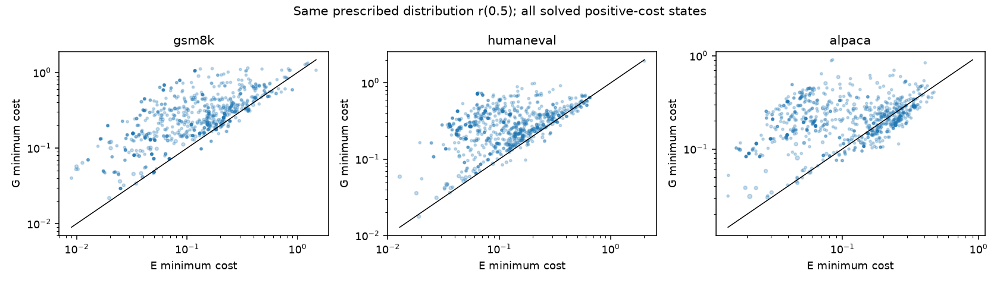
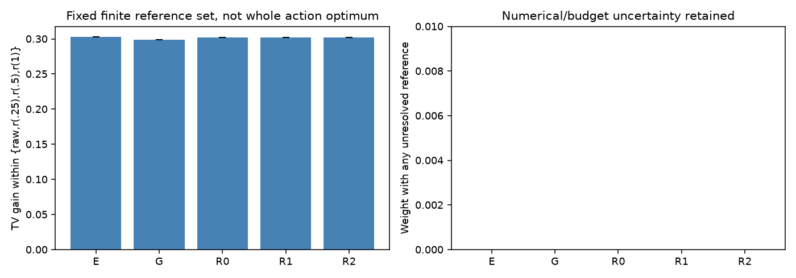
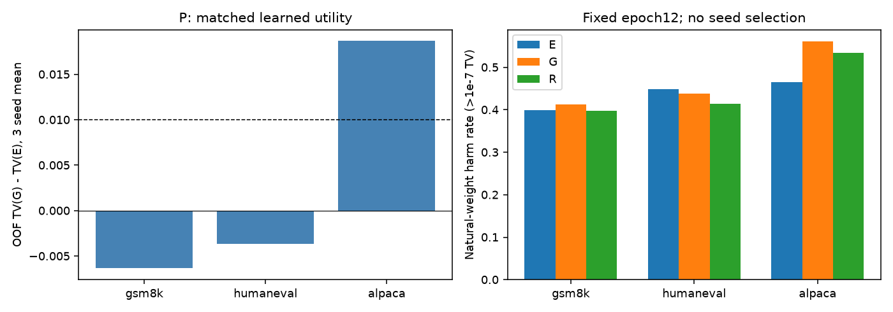

# 修正方向复用检验：实际结果

**额外价值：成本层为「已支持（本轮限定设定）」，同预算学习层为「不确定（未达到固定判据）」。** 折外同一r(.5)的log(G成本/E成本)=0.663695，描述区间[0.605722, 0.727212]，公共场景双边有限成本覆盖=100.00%。P全体学习TV差（G−E）=0.002892，区间[-0.008973, 0.016010]。二者必须分开，不能互相替代。全局尺度匹配成本差=0.366606；它不排除学习中的尺度、初始函数或优化解释。本轮完成全部27次CPU拟合及P/D/F评价；所有题已暴露，区间只作描述。未识别原部署因果、任意修正最小成本或接受/TPS收益。本轮收束，不自动扩实验。

## 固定问题与对照

只比较同一个错误、同一项规定概率修正：误差训练题提取方向E，纯全词表输出权重几何G，三个固定随机正交R。36题、69C；P自然槽9936，三来源29808。主位置3/8/15，当前EOS保留、EOS后排除，精确fresh_eval过滤。没有按原头成败、reached、novel、P-fit匹配或成本可解性选学习样本。

每域SHA排序mod3，三折24训练/12折外；同题所有C/来源同行。E和尺度只用该折训练P，G只看W，R固定seed。所有臂q输入投影为同一个G，仅输出方向来源不同。推理输入不含target。静态W/E张量数据SHA、原档276文件SHA及源码身份见审计。

概率：BF16位模式→FP32→FP64完整softmax。候选raw J Top256；其余logits固定，完整词表归一化。按槽→C→位置→题→域加权，自然重复H保留，等H仅评价敏感性。折内隔离不让旧题变成新fresh确认。

## 成本层：相同r(t)，而非任意同TV收益

在候选内向p插值，尾部保持q条件形状，t=.25/.5/1。该路径安全是数学定义保证，不是E来源证据。SVD直接分解A=W_S Bᵀ；成本为规定r(t)的最小系数范数/hidden范数。数值保护不是严格认证；截断、残差和预算边界均保留未定，不写不可修。

|主t=.5口径|log成本比|95%描述区间|双边有限成本原权重覆盖|判定|
|---|---:|---|---:|---|
|原尺度G/E|0.663695|[0.605722, 0.727212]|100.00%|已支持（本轮限定设定）|
|train-only统一尺度匹配|0.366606|[0.308570, 0.429808]|100.00%|已支持（本轮限定设定）|

公共场景是参考改善≥.01，原权重=0.832658；V权重=0.832658。所有条件均值沿完整面板原权重条件化，不重新等C或题。数值保护均值区间=[0.663695, 0.663695]。全公共场景范围：all public-scene weights defined; floating numeric guards reported。

|域|条件log(G/E)|有定义题数|P学习TV(G)−TV(E)|
|---|---:|---:|---:|
|gsm8k|0.722998|12|-0.006347|
|humaneval|0.603542|12|-0.003647|
|alpaca|0.661893|12|0.018669|

主判据：公共场景有限成本覆盖≥90%，至少两域各4有定义题，点估计≥log1.10、描述下界>0、两域正向，且浮点保护不跨幅度边界。只称覆盖子集条件成本线索。完整连续成本、场景内外、t敏感性、尺度保护界、R各次和三次全有效平均log比均保留。

成本配对图含全部正成本已解状态；点不是独立样本，大小按原权重。

预算图只针对固定四项参考集合；raw为零改善fallback。它不是完整动作族最优上下界。

## 同预算学习层

27次=3折×E/G/R×3seed，每次12完整epochs。CPU FP32原NOFILL网络（4,353,537参数），同初始化、同输入、同样本权重与顺序，AdamW lr3e−4/batch128，无早停/调参/挑seed。精确全词表KL动作项保留tail；评价用系数转FP64与canonical A，还原完整tail内部形状。

主P全体D_learn=0.002892，95%描述区间[-0.008973, 0.016010]，E自身改善=0.096635。三seed总体TV(G)−TV(E)：0.003423, 0.004288, 0.000964。固定判据是差≥.01、描述区间下界>0、三seed总体正向、至少两域正向且E自身改善>0；判定「不确定（未达到固定判据）」。

|来源|方向|epoch|raw TV|头TV|改善|损伤率(>1e−7)|损伤率(>.01)|top1命中|分布扰动TV|
|---|---|---:|---:|---:|---:|---:|---:|---:|---:|
|P|E|0|0.647938|0.647946|-0.000008|0.493409|0.037005|0.380273|0.013515|
|P|E|12|0.647938|0.551302|0.096635|0.437789|0.284979|0.451582|0.488824|
|P|G|0|0.647938|0.647877|0.000061|0.507780|0.018422|0.383263|0.008110|
|P|G|12|0.647938|0.554194|0.093743|0.470358|0.314365|0.465310|0.520792|
|P|R|0|0.647938|0.647877|0.000061|0.493570|0.009870|0.385610|0.006504|
|P|R|12|0.647938|0.559889|0.088049|0.448528|0.294978|0.457465|0.497181|
|D|E|12|0.581125|0.552975|0.028150|0.520158|0.405703|0.427244|0.478752|
|D|G|12|0.581125|0.557166|0.023959|0.540284|0.433128|0.434671|0.505709|
|D|R|12|0.581125|0.561087|0.020038|0.530768|0.417728|0.426247|0.486634|
|F|E|12|0.609248|0.541533|0.067715|0.470615|0.343332|0.450553|0.481187|
|F|G|12|0.609248|0.546320|0.062928|0.504919|0.383102|0.462481|0.512287|
|F|R|12|0.609248|0.548771|0.060477|0.480517|0.354585|0.453061|0.492360|

P是主面板，D/F只是固定外推；诊断raw始终J，F历史来自联合主体+原完整头，不叫joint raw轨迹。三臂参数初始化相同但初始分布不同；epoch0扰动表保留该差异，不能宣称已排除初始化解释。raw top1及逐fold/seed/题完整数据见CSV。

## 证据如何回答问题

成本回答同一个规定修正是否更省幅度；学习回答同预算固定输入头是否实际利用。任何单层阳性都不能代替另一层。oracle见p，头不见p；逐状态参考可行不保证一个共同预测能区分H，也不保证KL目标带来TV最优，失败不能直接叫容量或纯学习误差。

尺度匹配只做成本，不训练额外尺度头，不能排除学习的尺度、优化或初始化解释。全词表(p−q)W也不是掩码动作的系数梯度。三点参考收益不是整个动作族最优值。全部已暴露题的折外比较不是未见确认，也不能识别模型规模、联合训练或监督的形成因果。

## 全部覆盖、文件与局限

- REFERENCE_COSTS.csv / SCALE_MATCH_COSTS.csv：每状态三t、E/G/三R连续值、保护界、预算、NA，固定原权重。
- REFERENCE_BUDGET_GAINS.csv / COST_COVERAGE.csv：有限集合收益界、数值未定、场景外/全体覆盖。
- HEAD_OOF.csv.gz / HEAD_BY_PROMPT.csv / HEAD_BY_FOLD_SEED.csv / SOURCE_SHIFT.csv：所有来源、seed、epoch0/12，自然和等H评价；自然槽频数不作独立样本。
- DECISION.json：四种成本口径、R辅助、域/seed与固定判据。
- CASES.json / CASES_CN.md：SHA排序首六自然槽，重复H保留，不挑效果。
- qa/NUMERICAL_AUDIT.json / qa/TRAINING_IDENTITY.json：数值和身份；理论合同、文献矩阵另列。

bootstrap为域内整题配对5000次；描述区间条件于已拟合模型，没有处理跨折训练依赖。CPU代理头采用KL目标，与原BF16联合OUTPUT目标不同。旧R2 passed=false概率警报、R1条件KL未证主导、R2几何增量未支持、R3半强度不优以及机制发现零候选均保留，未由本轮替换。

必要工作全部完成才标complete。当前结果仅在上述固定回顾性代理设定内有效；不报告native接受收益/TPS，不自动下一轮。

## 预定补充：公共成本场景内外

以下沿P完整原权重条件化；不因结果选择场景，不重等C/题。场景NA另留，不能归到场景外。

|场景|原权重|G−E TV|描述区间|正/负/零/NA题|
|---|---:|---:|---|---|
|all|1.000000|0.002892|[-0.008973, 0.016010]|18/18/0/0|
|public_gain_ge_001|0.832658|0.003331|[-0.008867, 0.016001]|17/19/0/0|
|outside_public|0.167342|0.000705|[-0.021964, 0.026644]|17/15/0/4|

HEAD_COST_SCENE.csv保留各臂场景内外收益、损伤、覆盖；HEAD_SOURCE_PAIRED.csv保留每来源、每seed及三seed均值的整题描述区间与正负数。D/F不能挽救P主量。
