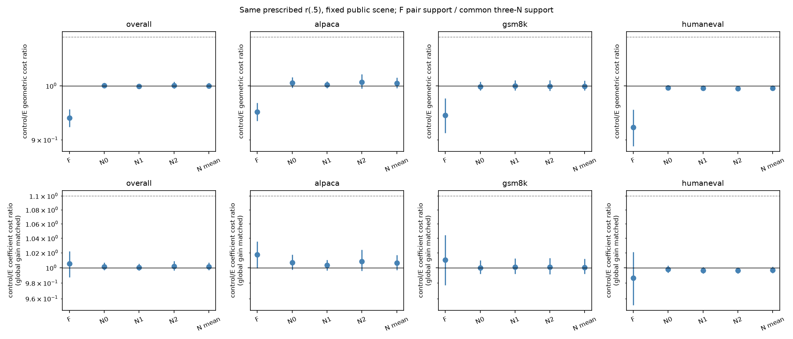
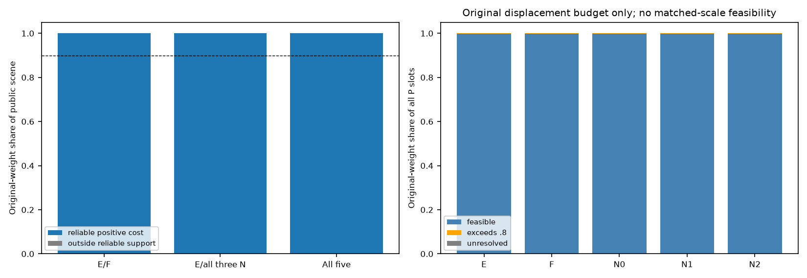

# 基底信息来源对照：实际结果

**结论：未建立正确配对的额外成本价值。** 同一r(.5)的log(F/E)原/匹配尺度为-0.062665/0.005283；三N共同支持集平均log(N/E)为0.000017/0.001400。F门槛未通过，N门槛未通过。成本层证据仅限此参考、两个具体竞争构造及旧题折外面板；匹配后未同时过线，尚未建立超出这一整体gain解释的联合来源优势。匹配后是系数成本，不是实际位移。没有训练、学习或部署新证据，不能认定唯一语义原因，也不能由未领先推等价。停止把真实配对特殊性当作已获支持的主张；这不证明几何或边际已充分解释。全部固定工作完成后本轮结束，不追加种子、秩、参考或训练。

## 固定问题和资产

正确大小模型预测对应是否比候选概率几何F、保两边加权边际而拆对应的N更省实现同一规定分布的幅度？旧E/G约.515（整体gain匹配后约.693）是背景，不再作新阳性证据；旧学习差.002892 TV区间跨0，E/G约99.8%/99.0%的r(.5)预算可行质量也保留。

只读R8与旧basis_reuse：36题、69C、207 C-i、9936 P自然槽、2571唯一(C,target_row)，J raw，fresh_eval，i3/8/15。三折按域内完整SHA排序mod3；各24训练/12折外，折外自然槽3168/3312/3456。三折主量按完整36题原权重，不直接平均折均值。当前EOS合法槽保留，未按头成败、reached、novel、P-fit匹配筛样本。所有题已暴露，折外不是新确认。

E只读三份旧基底。每折新增F及N0/N1/N2，共12个512维正交基底；未训练头、路由或主体，未加载/前向LLM、未采样、GPU0。

## 构造与可核验边界

F是训练候选raw概率下的KL曲率W_Sᵀ(diag(qS)−qS qSᵀ)W_S，逐C/i trace归一并累计原槽权重；只读S/logqs及静态W，不读p/pW/pS或reference_gain，qS不在Top256内重归一。F只是一个具体几何对照，不是所有几何法的最优上界。

N在训练同域同位置，以固定三个PCG64随机流、排列及圆周半周平移建立非均匀区间交叠耦合。每层在单位化前核行列边际；近零误差保持原质量，不重新归一。连续随机流按fold→域字典序→位置消耗，边表/排列/RNG状态全部保存。N会同时改变语境、候选对应和误差范数；不作置换p值。

CONSTRUCTION_AND_DECOUPLING.csv保存每折每臂谱、边界、正交性、相对矩阵变化、同槽/同C-i/同target身份剩余质量，以及真实/拆配误差长度分布。矩阵变化不是成本优势的证据，control_uninformative不能算E胜出。

## 四项主比较

公共场景U只由参考TV改善≥.01定义，含8249自然槽、2408唯一(C,i,H)，原权重0.832658；V_F及V_N均覆盖其中全部原权重。F/E在双边可靠正成本交集V_F比较；三个N先取E/N0/N1/N2共同交集V_N，每槽平均三个log比再聚合。下表相应支持集可能不同，不能相减制造F/N差。原/匹配尺度使用相同有效支持；全部原权重条件化，不重等C/题。

|比较|尺度|log(control/E)|95%描述区间|数值保护均值界|U内可靠覆盖|门槛|
|---|---|---:|---|---|---:|---|
|F|original|-0.062665|[-0.080495, -0.046049]|[-0.062665, -0.062665]|100.00%|未通过|
|F|global_gain_matched|0.005283|[-0.012539, 0.021868]|[0.005283, 0.005283]|100.00%|未通过|
|Nmean|original|0.000017|[-0.004582, 0.005456]|[0.000017, 0.000017]|100.00%|未通过|
|Nmean|global_gain_matched|0.001400|[-0.003239, 0.006885]|[0.001400, 0.001400]|100.00%|未通过|

门槛固定：V_F/V_N对U覆盖均≥90%，至少两域各≥4有定义题；四项点估计和浮点保护下界均≥log1.10，描述下界>0且两域正向；三N总体在两尺度各为正，控制须有信息。log1.10指对照/E≥1.10，不等于E少10%。任何未定质量的总体log比可能无界，可靠子集结果不自动覆盖缺失项。

|比较/尺度|Alpaca|GSM8K|HumanEval|正/负/NA题|bootstrap NA|
|---|---:|---:|---:|---|---:|
|F/original|-0.050709|-0.057453|-0.081300|4/32/0|0|
|F/global_gain_matched|0.017263|0.010577|-0.013465|21/15/0|0|
|Nmean/original|0.004937|-0.000858|-0.004486|16/20/0|0|
|Nmean/global_gain_matched|0.006251|0.000590|-0.003095|19/17/0|0|

三个N均在同一V_N上单列，不挑最好或最差：

|N|尺度|log(N/E)|描述区间|
|---|---|---:|---|
|N0|original|0.000284|[-0.004212, 0.005502]|
|N0|global_gain_matched|0.001672|[-0.002824, 0.006932]|
|N1|original|-0.000841|[-0.004928, 0.003857]|
|N1|global_gain_matched|0.000539|[-0.003656, 0.005310]|
|N2|original|0.000608|[-0.005062, 0.007618]|
|N2|global_gain_matched|0.001990|[-0.003722, 0.008993]|

图1：控制/E条件加权几何成本比。匹配尺度是系数单位；不是隐藏位移或训练速度。各域单列，非独立token区间。

图2：公共场景可靠支持覆盖、完整P原.8预算可行/超限/未定质量。匹配尺度不得用于原幅度可行性。

## 同场景与等H敏感性

全臂共同交集只作敏感性，不用不同子集均值相减，也不挽救主判据。等H只改评价权重，不重建基底。完整场景内外结果、逐题NA和原权重见CSV。

|口径|比较|尺度|log比|描述区间|覆盖|
|---|---|---|---:|---|---:|
|natural/all_intersection|F|original|-0.062665|[-0.080495, -0.046049]|100.00%|
|natural/all_intersection|F|global_gain_matched|0.005283|[-0.012539, 0.021868]|100.00%|
|natural/all_intersection|Nmean|original|0.000017|[-0.004582, 0.005456]|100.00%|
|natural/all_intersection|Nmean|global_gain_matched|0.001400|[-0.003239, 0.006885]|100.00%|
|equal_H/F_pair|F|original|-0.055611|[-0.071629, -0.039412]|100.00%|
|equal_H/F_pair|F|global_gain_matched|0.012336|[-0.003574, 0.028437]|100.00%|
|equal_H/N_common|Nmean|original|0.001195|[-0.002393, 0.005386]|100.00%|
|equal_H/N_common|Nmean|global_gain_matched|0.002571|[-0.001134, 0.006861]|100.00%|

## 证据层次和不能推出什么

同一r(.5)的唯一候选logit位移由完整尾部直接求和定义，所有臂解同一A a=d。SVD最小范数是标准工具，r安全是定义保证，均不作来源证据。只比较规定分布成本，不是任意同TV收益的全局最小成本。若A满行秩，成本差也不等于缺输出方向；没有满行秩不因截断就写不可修。

原B行正交，成本可对应修正向量幅度，不表示实际前向改动LLM隐藏态。train-only单个整体gain匹配后，只是系数成本；不表示更小实际位移、计算或训练时间。即使匹配后领先，也只排查此统一gain解释，不识别学习中的初始化/优化。

F与N非穷尽且非互斥的因果模型。未明显领先不等价，也不证明几何或两边边际足够解释全部失配。阳性最多支持当前单位化构造、固定模型对、规定修正及旧面板上的有限配对价值，不能叫唯一语义机制、失配形成原因、原头收益来源或部署价值。

全部区间为同一5000次域内整题配对bootstrap，所有臂/槽/折随题同时重采；保持完整原权重后在支持内条件化。条件于已建基底，不重估基底，不处理跨折训练依赖；有零分母重抽记NA且不补抽，不能用于阳性准入。

## 文件和审计

- REFERENCE_COSTS.csv.gz每行是一个自然槽/臂，natural_weight已含频数；count只是去重计算元数据，不能再乘count。去重计算原件在data/costs，H重复完整保留。
- PAIRED_COSTS / COMPARISONS / COVERAGE / BY_QUESTION / BY_DOMAIN：原/匹配尺度、自然/等H、全体/U内外、支持/NA和逐题逐域分母。
- BUDGET_COVERAGE：仅原.8幅度可行性。E_REFERENCE_CHECK只对齐旧E，不能当新科学证据。
- analysis/BASIS_CONSTRUCTION / N_COUPLING_AUDIT / SCALE_FACTORS及data/couplings边表：构造、边际、随机流、训练身份。
- qa/NUMERICAL_AUDIT / FINAL_CORE_REVIEW、RESOURCE_AUDIT、FILE_AUDIT及COMPLETION：数值、资源和收尾。浮点保护不是严格定向舍入证书。

旧原头学习未确认、双专家阴性和全部概率/资源披露继续保留，未由本轮覆盖。本轮无训练、GPU、native或TPS证据，终止于来源检验。
