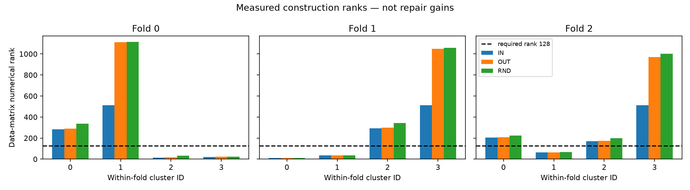
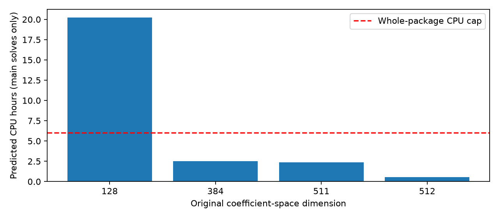

# 基底内部结构与上下文选择：执行结果

**状态：partial，不能回答四问。** 资产与小词表核验通过；固定聚类实际产生不足128秩的组，四组IN/OUT/RND库不能完整定义，fold0还有聚类未收敛标记。工程门禁的固定步数预测也超过6 CPU小时。Q1尚无全板稳定方向与删除证据；Q2尚无OUT对完整E512的全板界，不能说空间不够；Q3没有完成18个科学路由，不能说上下文无用；Q4没有完整组交叉效果，簇的领域成分不能充当任务偏好。这里只得到构造与资源限制，不是四项科学假设的阴性。没有改K/rank、补方向、删题或用GPU。旧来源特殊性阴性继续封存。本轮停止于门禁，必要工作未完成，不自动追加实验或下一轮。

## 实际执行与缺失

只读R8、basis_reuse缓存与静态W/embedding；36题、69C、207 C-i、9936 P自然槽、2571唯一目标。三折、自然权重和原档SHA通过重核。所有题已暴露，不是新确认。

完整词表KL、梯度、FW区间、旋转/最小范数、尾部条件形状与BF16位重解释已通过12组小词表合同。标准数学不作新发现。

初次门禁在真实低秩处退出；按指南补充NA传播，继续记录全部折的构造及可定义空间的工程计时。未定义组未填零，未补随机方向；各折簇号不拼成同一种功能。

复核时纠正了以1−|cos|代替夹角的实现错误，改为符号无关的实际弧度角，并重新核验全部三折。修前源码及构造单独保存；旧工程计时只用于维度吞吐，不用作修正后方向或聚类证据。固定阈值及迭代上限没有修改。

|fold|聚类状态|唯一历史数（四组）|IN秩|OUT秩|RND秩|
|---|---|---|---|---|---|
|0|cluster_unresolved|[349, 1354, 32, 22]|[284, 512, 15, 21]|[291, 1110, 16, 22]|[337, 1114, 32, 22]|
|1|valid|[12, 37, 363, 1260]|[12, 36, 292, 512]|[12, 36, 299, 1050]|[12, 37, 344, 1057]|
|2|valid|[239, 68, 202, 1204]|[205, 63, 171, 512]|[208, 63, 173, 969]|[225, 68, 199, 1002]|

这些是训练构造秩，不是错误共享方向、容量限制或任务适配的证据。

## 性能与停止理由

当前实现以2000步主上限、E512累计4000步及相应维度实测最慢吞吐外推。完整约118266次基础求解及2571次精化，剩余科学工作预测 26.40 CPU小时，乘1.5为 39.61小时；门槛为剩余预算80%，另留1200秒收尾。该预测不是实际已消耗量。缺失128方向组未被当成合法工程臂；因此完整科学门禁本身也不能称通过。

实际CPU/RSS/磁盘以RESOURCE_AUDIT与各阶段wait回执为准。没有GPU或模型前向。

## 四问证据边界

|问题|实际直接证据|当前答案|
|---|---|---|
|Q1 共用了哪些方向|小词表/构造秩及工程计时；全板删除和稳定方向缺失|未定，不能用谱或聚类图代替|
|Q2 组合不足还是空间不足|四组库不完整；完整OUT与E512最优值比较缺失|未定，低秩与未收敛不等于不可修|
|Q3 上下文能否选择|完整四列训练容量标签缺失；仅有计时用线性代数fixture|未测；不是18次科学路由结果|
|Q4 是否任务特化|只有各折构造/秩；训练定任务选择及折外交叉缺失|未测；簇成分不说明适配|

## 交付解释

CLUSTERS_AND_RANKS与秩图是实测；资源图是实测吞吐的预测外推。工程计时表保留实际迭代/未收敛数量；仅供数值/资源门禁，不升级为全板机制结果。Q1–Q4文件是显式NA状态清单，不能当已完成的科学表。要求的四张科学核心图尚未完成；提供的两张图是工程附图。六个案例按身份预选，未评价记NA。

未更换面板、K、rank、目标、剂量、阈值或seed。没有拟合科学路由、修复头或主体。旧basis_source来源特殊性未建立、旧学习阴性及概率/资源警报均保留。
