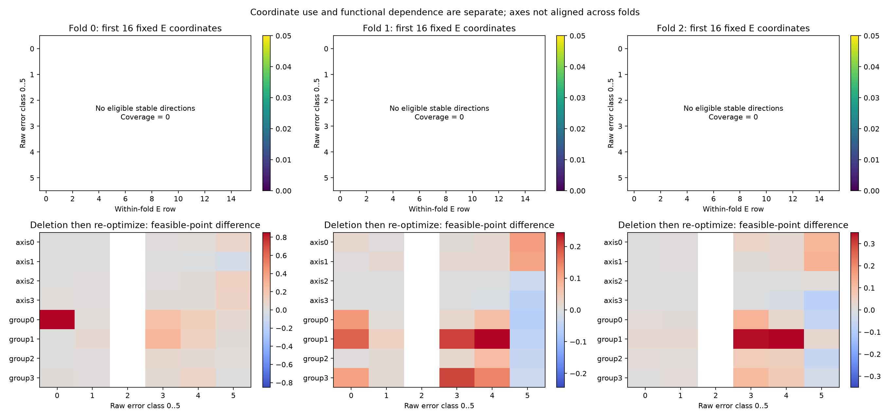
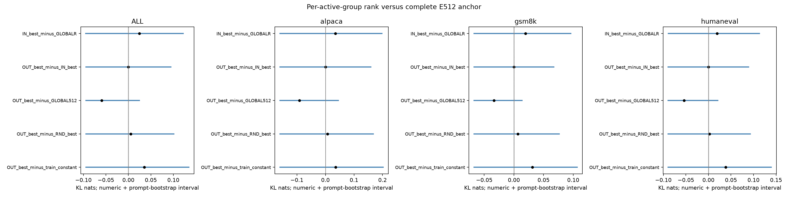
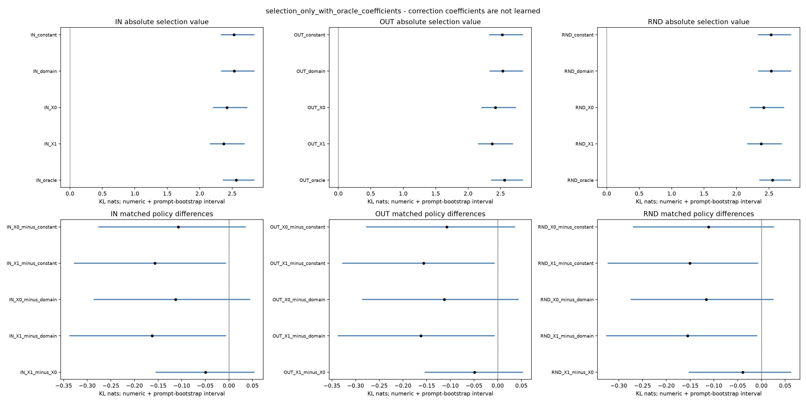
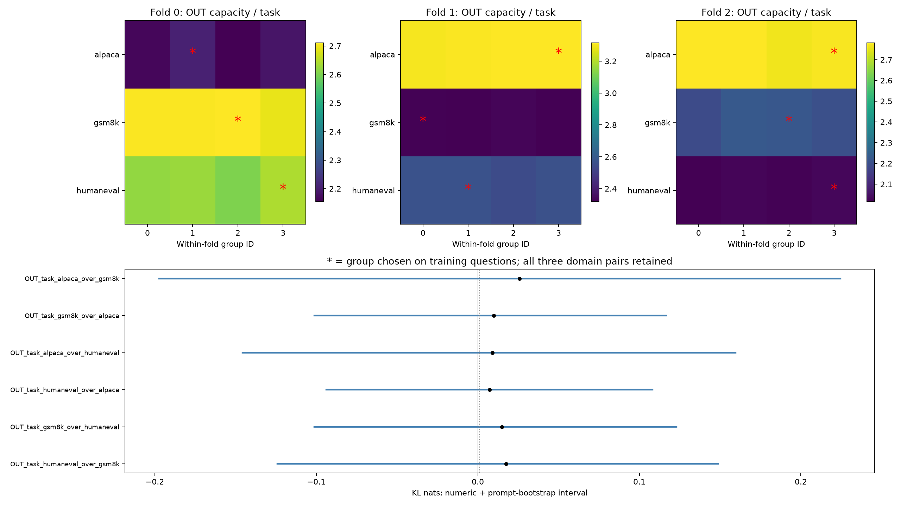

# 基底内部结构与上下文选择：重做结果

1. 不同错误：支持多类错误共同依赖方向组；单轴共用仍未定。

2. 空间：未建立完整E512存在平均空间缺口，不能把128维组间差异当成缺方向。

3. 上下文选择：未确认X0超过训练常量的实质选择价值；未确认增加前驱的增量。

4. 任务适配：未建立不同组分别擅长不同任务。

本次没有补采数据。训练内均衡分组解决小簇支撑不足，三折仍每组128维。但能力解全部未达到预设间隙，稳定方向覆盖0；组级删除的部分下界仍可判定，空间和最优选择则保留未定。18次路由已完成，仍搭配oracle系数。旧题折外仅作描述，旧阴性与概率警报保留。以complete_with_unresolved收束，不追加训练或下一轮。

## 数据身份、重做原因与结论范围

旧执行仅完成不均衡聚类与性能门禁，未完成四问；它的partial归档保持原样。小簇缺秩只说明当时组内独立残差不足，不能证明真实误差空间只有那些方向。本次按用户“重做”修复分组与等价求解工程，未增加样本、改变主目标或借新run重置预算。

固定P来源、fresh_eval、J raw、i=3/8/15；36题、69C、207 C/i、9936自然槽、2571唯一(C,target_row)。三折各24训练题/12折外题，折外槽3168/3312/3456。自然重复H保留频数，计算去重。样本→C→位置→题→域沿原权重；错误类型等子集只对原权重条件化。当前EOS合法槽保留，EOS后不补。

训练单位残差的4组轴向聚类加入等唯一历史数配额，精确分配后更新主轴；三折组数分别440/439/439/439、418/418/418/418、429/428/428/428，全部IN/OUT/RND数据秩均≥343，最终统一rank128，不补随机方向。均衡是支撑控制，不是发现天然四种错误；本实验不能替代补采稀有自然历史。

基底/聚类/标准化/路由/任务选择只读各折训练题。原E512的身份来自相应训练折。所有数据此前已用于机制研究，折外只是本次回顾性隔离，不是新确认。旧basis_source对F/N的来源特殊性额外价值未建立，本轮不重测或覆盖它。

## 共同数值合同与覆盖

每空间在同rawTop256、同.8||h||球内最小化完整forward KL的动作项。尾部保留原logits并参与完整归一化，所有TV逐词表计算。先BF16位重解释FP32，再FP64。每个可行系数、收益上下界、FW间隙、迭代数都保留；数值保护不叫严格有向舍入证书。

118266个训练/评价状态×空间单元、2571个E512方向续算全部保存。评价能力的自然权重未收敛比例=100.000000%；稳定非零方向覆盖=0.000000%。未收敛状态没有从主收益界中删除；方向分析只在合同允许的稳定非零子集上解释，NA另报。

完整E512解析达到候选自由最优的覆盖：0.000000；数值界[0.000000,0.000000]；描述区间[0.000000,0.000000]。这只指Top256可改、尾部条件比例固定的当前动作集合；尾部内部失配可继续存在。它不是全部分布一致，也不是原头已达到该能力。

计算只对等价批处理、行空间SVD、计算填充及满足原FW/半径/重建的解析候选使用快路径。填充不增加统计样本；FW每10步检查一次，原每步可行目标保留，固定迭代轨迹不变。一般状态仍按原2000步、方向累计4000步执行。

固定工程C的原矩阵FW重建审计通过，最大间隙误差约3.8e−13；未新增优化步骤。该C完整E512三个位置的候选自由最优最小系数范数约为半径的1.10、3.04、2.58倍，因此解析自由最优快路径不能直接使用。此为数值原因核查，不推广为全板空间不足。

## Q1：哪些方向共用，哪些只是可替代坐标

支持多类错误共同依赖方向组；单轴共用仍未定。

全部512个固定E坐标的长度、正负与能量见Q1_DIRECTION_USAGE及Q1_COORDINATE_SUMMARY；正文只展示锁定的前16项。投影重叠不等于边际价值，重叠组的能量也不能相加成解释率。四根训练首轴和四个IN组均从完整E512删除后重新优化，剩余方向可以补偿。

功能共用准入：同fold同轴/组、至少两种错误各≥4题，删除损失数值均值下界≥.001 nats；单轴还须首特征向量可识别。删组受损不能写成组内同一单轴必需。删除无损只排除当前动作/预算下的不可替代性，不证明该方向从未使用。

[方向与删除表](Q1_REMOVAL.csv)；[全部判定](Q1_SHARING_DECISION.csv)；[六错误覆盖](ERROR_CLASS_COVERAGE.csv)；[几何与跨折角度](SPACE_GEOMETRY.csv)。跨折簇号不对应同一功能。

三折共12个IN组均在至少两类错误上通过组依赖门槛，12根首轴均未通过单轴门槛。稳定方向覆盖为0，具体向量方向/符号/幅度不作解释。未通过不能当成没有单轴共用。

|fold|删除的IN组|达到门槛的错误格（0基）|这些格的最小删除损失下界|
|---|---|---|---|
|0|0|[0, 1, 3, 4, 5]|0.002317|
|1|0|[0, 4]|0.006008|
|2|0|[3, 4]|0.008975|
|0|1|[1, 3, 4]|0.011787|
|1|1|[0, 3, 4]|0.098632|
|2|1|[1, 3, 4]|0.003029|
|0|2|[3, 4, 5]|0.008158|
|1|2|[4, 5]|0.007341|
|2|2|[3, 4]|0.023995|
|0|3|[0, 1, 3, 4, 5]|0.001694|
|1|3|[0, 3, 4]|0.041342|
|2|3|[3, 4]|0.003954|

删除图展示可行点之差，负值只能说明当前两解精度不同；嵌套空间的真实最优删除损失非负。功能依赖按表中数值下界判定，且只在同一.8范数预算内成立，不能说方向唯一或原头独占用途。

## Q2：换组合/幅度，还是完整空间不够

|固定比较|点值；数值界；95%描述区间|冻结判定|
|---|---|---|
|IN_best_minus_GLOBALR|0.024579；数值界[-0.078313,0.102892]；描述区间[-0.094653,0.122171]|不确定／未过冻结门槛|
|OUT_best_minus_IN_best|0.000016；数值界[-0.078297,0.078313]；描述区间[-0.094652,0.094653]|不确定／未过冻结门槛|
|OUT_best_minus_GLOBAL512|-0.059560；数值界[-0.078297,0.018737]；描述区间[-0.094652,0.024332]|不确定／未过冻结门槛|
|OUT_best_minus_RND_best|0.005423；数值界[-0.078297,0.083720]；描述区间[-0.094652,0.101041]|不确定／未过冻结门槛|
|OUT_best_minus_train_constant|0.035135；数值界[-0.078297,0.113433]；描述区间[-0.094652,0.134732]|不确定／未过冻结门槛|

OUT-best与IN-best均看过p，只测能力。现有空间不足必须由OUT可行收益下界超过完整GLOBAL512最佳收益上界，不能拿OUT胜128维锚点替代。所有局部负例、数值未定与确定>.001状态保留在Q2_SPACES_STATES，不以正例替换完整面板。

同C/i、不同完整H的方向余弦、长度比与候选logit作用方向另见Q2_CONTEXT_PAIRS及Q2_HISTORY_SUMMARY。先对不同H对等权，再沿原C/位置/题/域权重；不把重复采样当新历史。方向不稳定或近零为NA，不能据少量可识别历史概括所有历史。即使不同历史所需系数不同，也不自动说明需要扩大空间。

聚类库相对随机分组与训练常量均需过门槛，并在同fold至少两个组各获≥4题独优见证，才记聚类选择价值；本次结果：未建立。随机对照保留域/位置/权重边际，改变质量≥10%才有效；不能因四者取max天然较大而宣称聚类有用。

## Q3：可见上下文能选什么

X0仅现有h/q/i，X1只加实际前驱embedding。固定ridge λ=.001，无调参，共18次闭式拟合。所有OOF预测先签名，预测worker没有读取折外能力标签。常量与领域单组也只用训练题决定。训练标签四组同时收敛的质量不足99%时，主容量解释记未定，实际可行收益仍完整报告。

**全部选择结果均为selection_only_with_oracle_coefficients**。路由只选空间，选中后的修复系数仍由p离线求解；它不证明可部署修复、接受率或TPS。

|OUT库比较|点值；数值界；描述区间|判定|
|---|---|---|
|X0 − constant|-0.107205；数值界[-0.192542,-0.032777]；描述区间[-0.276673,0.035341]|未支持（未到预设幅度）|
|X1 − constant|-0.156398；数值界[-0.243878,-0.079850]；描述区间[-0.327011,-0.007532]|未支持（未到预设幅度）|
|X0 − domain|-0.112916；数值界[-0.202919,-0.028112]；描述区间[-0.284929,0.043028]|未支持（未到预设幅度）|
|X1 − domain|-0.162109；数值界[-0.252602,-0.076836]；描述区间[-0.336385,-0.007426]|未支持（未到预设幅度）|
|X1 − X0|-0.049193；数值界[-0.092362,-0.006046]；描述区间[-0.152923,0.052005]|未支持（未到预设幅度）|

IN与RND同样全报，避免把OUT有信息说成“聚类特有信息”。按同fold/库实际标准化输入字节建等价类，Q3_INPUT_ALIAS_BOUNDS给同输入只能统一选组的最好容量界；也报告C/i和C/i/前驱类。这个上界读过p，只界定当前输入对当前四组的选择损失，不能用于部署或推断所有上下文都无效。若类里只有一个H，零差只是定义。

## Q4：组是否各自适合不同任务

未建立不同组分别擅长不同任务。

每fold独立给三个数据集×四组的全部交叉评价，及六种概率错误×四组；不跨fold对齐组号。三个预先域对全部双向报告，训练任务优选组相同时该fold差记0并保留权重。至少一个域对两个方向都过.001 nats/区间/覆盖门槛，才记任务适配差异。

Q4_TASK_BY_GROUP、Q4_TASK_CROSSOVER与CLUSTER_COMPOSITION分别记录效果与构成；簇里某领域多不等于擅长该领域。不能用“某组有较多代码题”命名语法专家或认定训练因果。

## 完整TV、统计、案例与未知边界

ALL_METRICS列全部22空间完整TV/top1/损伤率，Q3_ROUTING给选择后的对应结果。KL与TV不是同一个目标；即使KL改善也不能直接写接受率改善。EQUAL_H_SENSITIVITY只重权评价、不重拟合，保留自然频数为主分析。

5000次域内整题配对bootstrap，seed2026101741；每域抽12题，所有状态/臂随题一起走，分别重采数值差下/上界。固定基底与模型不重拟合，也未解决重叠训练折依赖；区间只描述旧样本条件变化。缺失分母为NA，不补抽、不按显著性扩搜。

[六个身份预选案例](CASES_CN.md)及CASE_TOKEN_LEDGER保留完整词表概率和逐token账本。按每域SHA前两题、最小anchor、i3首slot选择，不按收益挑例；OUT为oracle组。OTHER先逐词算误差再求和，不能当合桶TV。

本轮没有识别低成本模型误差的训练原因、规模因果或生成部署收益；均衡训练分组也未证明自然错误只有四类。旧R1条件KL主导未证、R2几何增量未支持、R3统一半强度不优、basis_reuse学习优势未确认、basis_source来源特殊性未建立和原R2概率passed=false警报均继续保留。

## 交付与停止

详见METHOD_CN、THEORY_CARDS_CN、CLAIM_EVIDENCE、NUMERICAL_AUDIT及FINAL_CORE_REVIEW。预算按本包旧partial与本次redo累计，GPU=0；资源实际值在最终RESOURCE_AUDIT与COMPLETION。四问固定工作已执行，数值宽区间继续标未定。不因为剩余预算追加新K、rank、目标、训练或下一轮。
