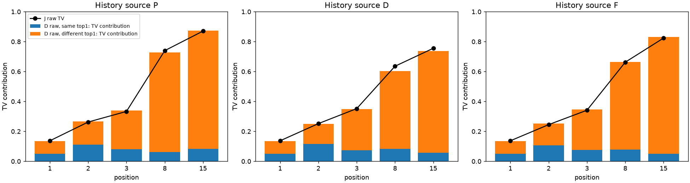
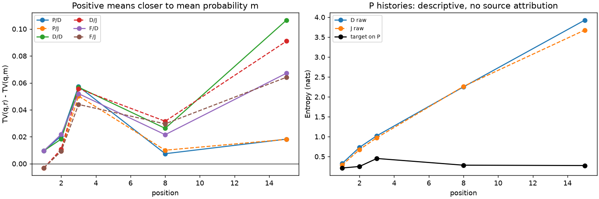
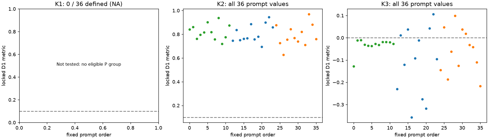
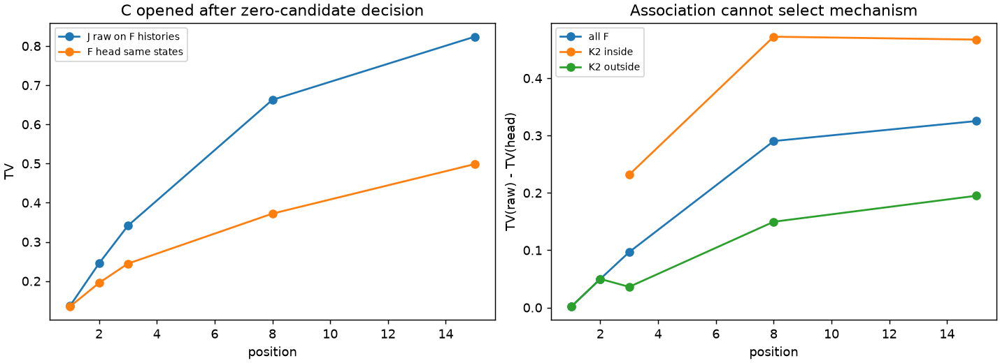

# 具体失配机制发现：零候选收束

本轮没有选出可推荐为新增机制的小切口。明确重复的错误是：target首选已在raw Top16、但raw首选不同的场景里，该token仍被明显低估；P历史上三域各12/12题满足冻结欠量方向。这与[DCOCO](https://arxiv.org/html/2610.12570v1)/[DSpark](https://arxiv.org/html/2607.05147v1)等已知候选重选及条件缺失问题重合，尚不能定位本地的错误来源。

试图排除多模态分歧的高置信全历史同意场景，在P主面板0/36题有定义，属于未检验，不是反证。硬标签假说的必要预测也未支持：三域仅4/12、4/12、0/12题更靠近argmax频数。三个候选的来源鉴别D2均缺匹配干预。

因此停止推荐，不换阈值补救，不启动新训练。C附表虽有局部改善，只说明方法关联，不能挽救已封存的零候选决定。尚未证明输出层、监督、位置预算或条件融合是主要起因。

---

## 证据范围与固定数值

这是R8已暴露36题、69C的回顾性分析。69C×3来源×5位置×48 eval槽=49,680合法自然槽，D/J展开99,360行；不是99,360个独立样本。72个可能anchor中3个C65缺失，固定面板为已有69C，不补采。pool严格为fresh_eval。全部eval槽valid，面板内invalid/NA为0；缺anchor在独立NA表保留。EOS当前合法位置保留，未从其他来源补齐。

uint16 BF16位模式经FP32到FP64全词表softmax；151,936词，tie取最小ID。所有49,680条target buffer SHA核验；独立审计另用字节布局解码及overlap-TV重算两个身份预选C，不冒称全库双实现复算。自然重复H保留，完整文件SHA前后核对。

每source/body/position：C内槽等权→题内C等权→域内题等权→域等权。另给C内等H版，不依结果挑版本。所有题/C/槽/H分母见[COVERAGE](COVERAGE.csv)和[数值审计](../qa/NUMERICAL_AUDIT.json)。没有新增显著性检验。

## A：原始错误的落点

下表是P来源的域等权自然频数结果；D/F及域/题面、margin、熵、两首选对应概率和等H结果均在[完整A表](RAW_ERROR_MAP.csv)、[逐题表](RAW_ERROR_MAP_BY_PROMPT.csv)，未按头成败/novel/fit匹配/reached筛选。

|raw|位置|TV|top1一致率|一致组TV贡献|p在Top16质量|p在Top256质量|
|---|---:|---:|---:|---:|---:|---:|
|D|1|0.135654|0.875000|0.049983|0.994698|0.999951|
|D|2|0.266526|0.796875|0.111627|0.971745|0.994691|
|D|3|0.339081|0.627025|0.080014|0.949608|0.983118|
|D|8|0.727334|0.284433|0.061180|0.729126|0.955447|
|D|15|0.873134|0.176215|0.083532|0.629131|0.911809|
|J|1|0.137167|0.902778|0.055467|0.994289|0.999923|
|J|2|0.262448|0.784433|0.092113|0.985277|0.998217|
|J|3|0.333352|0.657407|0.088888|0.935858|0.984745|
|J|8|0.739838|0.291088|0.082284|0.756133|0.960953|
|J|15|0.870623|0.206597|0.109921|0.628674|0.927932|

一致/不一致两组的频率×条件TV均值，使用原总体权重，相加精确还原总体TV；子组重新归一的条件均值另列。后部错误不能只叫候选缺失，也不能把TopK覆盖当语义理解或hidden充分性。后部raw更弥散是已测描述，尚不能区分条件混合、监督预算、表示或优化来源。

## B：监督描述不支持直接硬标签归因

m是同C/i/source自然频数平均p；r是target argmax频数，均不是声称的TV最优或真实加权训练标签分布。下表为TV(q,r)−TV(q,m)，正值表示更靠近m。

|来源/raw|i1|i2|i3|i8|i15|
|---|---:|---:|---:|---:|---:|
|P/D|0.009596|0.020512|0.057350|0.007417|0.018244|
|P/J|-0.003200|0.009538|0.050243|0.010002|0.018073|
|D/D|0.009596|0.018271|0.056776|0.026245|0.106573|
|D/J|-0.003200|0.010798|0.055661|0.031520|0.090973|
|F/D|0.009596|0.021758|0.051996|0.021540|0.067180|
|F/J|-0.003200|0.009281|0.043970|0.029572|0.064179|

raw CE确用teacher argmax，repair另有完整概率OUTPUT；这是源码事实，不是原因证据。i1单H时m/r差含数学硬化，不能作新发现。TV(q,m)也不是mean TV(q,p_H)。[B全表](SUPERVISION_DIAGNOSTIC.csv)保留自然/等H以及各C。[文献矩阵](LITERATURE_MATRIX_CN.md)逐项区分作者主张、干预和本地推断。

## 三候选的必要预测与来源缺口

候选在A/B已读之后形成，仍是探索；锁定不使旧数据变成新留出。三个D1可在场景内失败；三个D2需要当前没有的受控资产，均标unavailable，没有用相关性替代。全部每题正负例和NA见[CANDIDATE_D1_BY_PROMPT](CANDIDATE_D1_BY_PROMPT.csv)；完整候选/指标/阈值/反例/源码/近邻在[候选锁](../protocol/CANDIDATE_LOCK.json)。

|候选|P主面板有定义题G/H/A|满足冻结方向题G/H/A|判断|
|---|---|---|---|
|K1 高置信同意历史的后部欠量|0/0/0|NA/NA/NA|数据不能区分；不放宽条件救覆盖|
|K2 Top16候选内低估|12/12/12|12/12/12|必要现象成立；已有工作覆盖宽泛创新，具体来源未识别|
|K3 raw更靠近硬频数|12/12/12|4/4/0|必要预测未观察到；不等于真实监督因果被否定|

K1固定i8/15、至少两种完整H、全体target top1相同、自然mean p(a)≥0.9。没有合格P组，所以不能声称观察到“排除历史混合后仍欠量”。位置加权与条件融合只是竞争假说。K2固定i3/8/15、target首选在raw Top16且非raw首选，主量p(a)−q(a)>0.1；三域题均值分别0.806807、0.789928、0.821673。这个方向并非由场景定义保证，但仅与已知问题一致，不确认原因。K3固定TV(m,r)≥0.1，主量TV(q,m)−TV(q,r)>0；三域均值−0.108553、−0.059834、−0.033241，保留8个方向正题与28个负题。D/F另表只描述，不能救P门槛。

宽泛候选重选已见DCOCO，条件修正已见Domino/DSpark；D-PACE已有位置预算动机；DistillSpec/LK已有目标选择影响。论文已有机制不证明它就是当前原因。没有候选归入“可进入受控检验”；也没有将缺干预写成来源反证。

图中蓝/橙/绿分别为GSM8K/HumanEval/Alpaca；每点为完整题面，K1的NA没有绘成0。

## C：选点封存后才读取的方法关联

[FINAL_SELECTION](../protocol/FINAL_SELECTION.json)先签名，选中0个，之后才核SHA并打开封存F标量。该代码只按同C、同F-eval记录的target_row与F_head_row配p/q_J/q_F；不同source同slot不配对。F是联合主体加完整原头生成的历史，不是J raw轨迹。

|位置|全F raw TV|head TV|改善|受损率(1e−7)|
|---|---:|---:|---:|---:|
|1|0.137167|0.135263|0.001904|0.236111|
|2|0.245066|0.195198|0.049868|0.307870|
|3|0.341370|0.244585|0.096784|0.227720|
|8|0.662574|0.372201|0.290373|0.101273|
|15|0.823800|0.498597|0.325203|0.107060|

[全F及全部冻结场景内/外表](HEAD_CONNECTION.csv)、[逐域表](HEAD_CONNECTION_BY_DOMAIN.csv)、[逐题全F表](HEAD_CONNECTION_BY_PROMPT.csv)同时给覆盖与等H敏感性。场景无定义保留NA，不填效果0。表内外使用原总体权重作条件比值；没有为稀薄子组重选题/阈值。头在K2的局部收益不能识别条件缺失或监督/映射的因果，也不能据此重选K2，更不外推native接受或TPS。

## 完成范围与停止

固定A/B/C和三候选D1、D2不可用判定均完成。最终零候选是科学收束，不是资源不足。没有选中者，因此[后续检验文件](NEXT_CONTROLLED_TEST_CN.md)明确不推荐新干预；不为了给下一轮而再交训练计划。本轮没有确认新的形成机制、模型规模因果、隐藏状态充分性或输出层主因。

R1条件KL主导未证、R2几何解释增量未支持、R3统一减半不优、R6历史风险/方向未确认及R2原native passed=false保持。R9的共同安全空间不自动解释当前来源。各轮不同测度不拼成AC/TPS原因占比。

只读旧概率，没有模型加载、GPU、采样、训练、LP或环境安装；大NPZ按C原位读取，未整档复制或生成全库FP64矩阵。资源/进程身份与静态SHA在RUN_AUDIT及COMPLETION；所有控制文件变化留审计。原论文按定向章节核对，不声称穷尽新颖性。AI协助实现、数值核验、检索与报告。

本轮保守CPU账约0.17小时，GPU=0；完整概率扫描约126.5 CPU秒，峰值RSS约0.47 GiB，新增文件约8 MiB，精确收尾值以RESOURCE_AUDIT为准。没有资源超限，科学扫描/诊断没有技术重试；归档动态CPU账本的清单分类有一次已定位修复，记录见CLOSURE_REPAIR；资源账工具从早期2秒采样收尾改为完整waited-child rusage，旧记录与420秒控制/收尾保守余量保留，不冒称早期采样等于精确进程树CPU。
