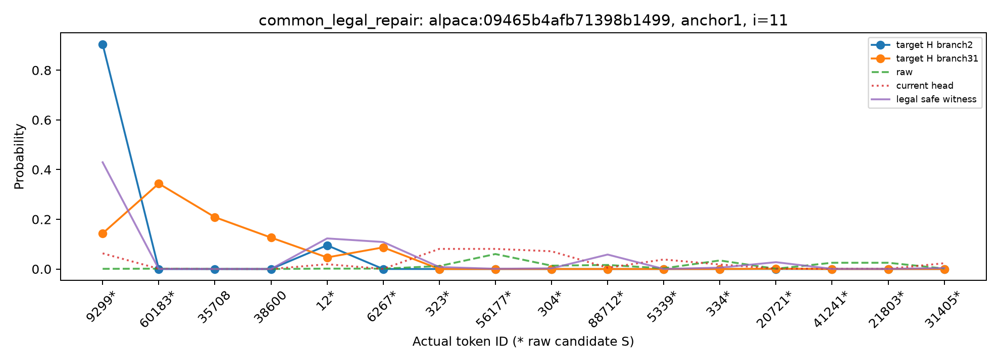
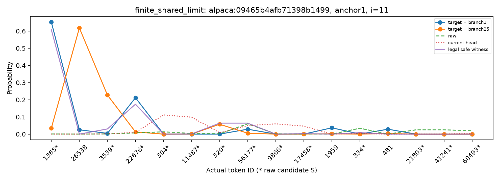

# R4 三类真实机制案例

本页解释原固定排序选择出的新题案例，不增加选择条件。它们使用全部固定分支作有限组描述；独立fit→eval证据见 RESULTS_CN.md 与 FIT_EVAL_REPORT.json。

同组完整输入、完整raw/当前头输出相同，更早历史不同。图只显示至多前4条不同H的分支和16个token坐标；下列分支表保留全体自然频数，TV、尾部质量和oracle全部使用完整词表。安全约束以raw为参照，数值容差不是严格零损伤。

安全替代可能减少当前头在原好分支上的部分收益；不比raw差，并不表示逐分支优于当前头。下表完整保留这种取舍。

## 共同可修

题面片段（最多200字符；完整messages见锁定清单）：

> Describe a hypothetical business opportunity.

C末20个token的文本片段："<\|im_start\|>user\nDescribe a hypothetical business opportunity.<\|im_end\|>\n<\|im_start\|>assistant\n<think>\n\n</think>\n\n**"。完整C身份SHA256 `5ff66accc487d09b4635dc769195d6065858c4901018a3b477cdf541b111edc3`。

题目 `alpaca:09465b4afb71398b1499`，`anchor1`，位置i=11，组45。该类合格组2344；按锁前字典序选取，存在其他合格组时避免案例复用。

| 有限组量 | 数值/边界 |
|---|---|
| raw平均TV | 0.993714660 |
| 当前头平均TV | 0.914699364 |
| 已找到的最佳合法平均TV | 0.597197521 |
| 已找到的安全合法平均TV | 0.597197521 |
| 逐状态放宽最优R_ind | 0.186420749 |
| 共同放宽最优R_shared | [0.405052084, 0.405052387] |
| 安全共同放宽最优R_safe | [0.405052094, 0.405052125] |
| 共享代价 | [0.218631335, 0.218631638] |

每行保留一条自然采样分支，重复历史也保留原频数。H只列本proposal块中位置i以前的历史；C由原完整token文件绑定。

| 分支/池 | H token IDs | H文本（仅辅助阅读） | 前驱 | raw TV | 头 TV | 安全见证 TV | target尾部质量 |
|---|---|---|---:|---:|---:|---:|---:|
| 2/fit | [39, 1082, 8767, 44508, 8025, 47279, 25, 60493, 11, 15235] | "Hypothetical Business Opportunity: Sustainable, AI" | 15235 | 0.997818768 | 0.917830487 | 0.475207726 | 0.000001319 |
| 31/eval | [39, 1082, 8767, 44508, 8025, 47279, 25, 19207, 1506, 15235] | "Hypothetical Business Opportunity: Personalized AI" | 15235 | 0.989610552 | 0.911568241 | 0.719187315 | 0.376390377 |

安全见证 `proxy_from_safe_R_KL_it96`，实际BF16 dose=0.80078125；原direction/coeff/selected logits完整值见固定案例JSON及源见证。对应basis数值秩256/256，条件数92.613465。这是连续数值诊断，不能据秩推断有限dose和BF16全局可达。

U总质量：raw=0.293202931；当前头=0.164192619；安全见证=0.071592889。总质量可以变，U内部条件比例保持原样。

共同/安全证书间隙：0.000000303 / 0.000000031；完整LP乘子与切线绑定见 ORACLE_CERTIFICATES.jsonl。

这个案例支持：至少有一个按真实冻结更新算术执行的共同动作，改善了每条观察分支。它是可行见证，不是已证明的最优值，也不是target不可见时可以直接部署的新头。

源见证：`data/fresh_test/alpaca_09465b4afb71398b1499/WITNESS_ANALYSIS/anchor1/groups/g45.json`；SHA256 `a9319a895dfbe464d990407fe885d7c974a9fb452b8c67a6a1dd9598eede9c15`。

## 有限分支的共享限制

题面片段（最多200字符；完整messages见锁定清单）：

> Describe a hypothetical business opportunity.

C末20个token的文本片段："<\|im_start\|>user\nDescribe a hypothetical business opportunity.<\|im_end\|>\n<\|im_start\|>assistant\n<think>\n\n</think>\n\n**"。完整C身份SHA256 `5ff66accc487d09b4635dc769195d6065858c4901018a3b477cdf541b111edc3`。

题目 `alpaca:09465b4afb71398b1499`，`anchor1`，位置i=11，组47。该类合格组1601；按锁前字典序选取，存在其他合格组时避免案例复用。

| 有限组量 | 数值/边界 |
|---|---|
| raw平均TV | 0.964629703 |
| 当前头平均TV | 0.954112396 |
| 已找到的最佳合法平均TV | 0.510855368 |
| 已找到的安全合法平均TV | 0.510855368 |
| 逐状态放宽最优R_ind | 0.368313252 |
| 共同放宽最优R_shared | [0.469439758, 0.469440402] |
| 安全共同放宽最优R_safe | [0.469439759, 0.469440401] |
| 共享代价 | [0.101126505, 0.101127149] |

每行保留一条自然采样分支，重复历史也保留原频数。H只列本proposal块中位置i以前的历史；C由原完整token文件绑定。

| 分支/池 | H token IDs | H文本（仅辅助阅读） | 前驱 | raw TV | 头 TV | 安全见证 TV | target尾部质量 |
|---|---|---|---:|---:|---:|---:|---:|
| 1/fit | [39, 1082, 8767, 44508, 8025, 47279, 25, 7840, 34097, 18539] | "Hypothetical Business Opportunity: GreenTech Living" | 18539 | 0.955117232 | 0.949570279 | 0.176124088 | 0.094240821 |
| 25/eval | [39, 1082, 8767, 44508, 8025, 47279, 25, 28322, 7840, 18539] | "Hypothetical Business Opportunity: Urban Green Living" | 18539 | 0.974142175 | 0.958654513 | 0.845586648 | 0.647181423 |

安全见证 `proxy_from_safe_R_KL_it96`，实际BF16 dose=0.80078125；原direction/coeff/selected logits完整值见固定案例JSON及源见证。对应basis数值秩256/256，条件数92.613465。这是连续数值诊断，不能据秩推断有限dose和BF16全局可达。

U总质量：raw=0.293202931；当前头=0.176791709；安全见证=0.001126600。总质量可以变，U内部条件比例保持原样。

共同/安全证书间隙：0.000000644 / 0.000000642；完整LP乘子与切线绑定见 ORACLE_CERTIFICATES.jsonl。

这个案例支持：在指定放宽集合与有限观察历史上，共用修正比逐历史修正有可认证的额外代价。它不证明当前头造成的损伤不可避免，也不证明所有其他历史、动作或网络均受同一限制。

源见证：`data/fresh_test/alpaca_09465b4afb71398b1499/WITNESS_ANALYSIS/anchor1/groups/g47.json`；SHA256 `c4a445fd93f7ece8d278db8f0fcd136c0d6b63fe7b2b48a6d55b15efb0eb06af`。

## 当前头存在安全共同替代

题面片段（最多200字符；完整messages见锁定清单）：

> Describe a hypothetical business opportunity.

C末20个token的文本片段："<\|im_start\|>user\nDescribe a hypothetical business opportunity.<\|im_end\|>\n<\|im_start\|>assistant\n<think>\n\n</think>\n\n**"。完整C身份SHA256 `5ff66accc487d09b4635dc769195d6065858c4901018a3b477cdf541b111edc3`。

题目 `alpaca:09465b4afb71398b1499`，`anchor1`，位置i=12，组68。该类合格组153；按锁前字典序选取，存在其他合格组时避免案例复用。

| 有限组量 | 数值/边界 |
|---|---|
| raw平均TV | 0.984857955 |
| 当前头平均TV | 0.976454821 |
| 已找到的最佳合法平均TV | 0.533302680 |
| 已找到的安全合法平均TV | 0.533302680 |
| 逐状态放宽最优R_ind | 0.449275930 |
| 共同放宽最优R_shared | [0.498908730, 0.498909160] |
| 安全共同放宽最优R_safe | [0.498908733, 0.498909159] |
| 共享代价 | [0.049632801, 0.049633230] |

每行保留一条自然采样分支，重复历史也保留原频数。H只列本proposal块中位置i以前的历史；C由原完整token文件绑定。

| 分支/池 | H token IDs | H文本（仅辅助阅读） | 前驱 | raw TV | 头 TV | 安全见证 TV | target尾部质量 |
|---|---|---|---:|---:|---:|---:|---:|
| 5/fit | [39, 1082, 8767, 44508, 8025, 47279, 25, 50851, 43, 35322, 18539] | "Hypothetical Business Opportunity: EcoLuxe Living" | 18539 | 0.984581076 | 0.984763982 | 0.166231821 | 0.101437772 |
| 16/eval | [39, 1082, 8767, 44508, 8025, 47279, 25, 50851, 6222, 33472, 18539] | "Hypothetical Business Opportunity: Eco-Smart Living" | 18539 | 0.985134834 | 0.968145661 | 0.900373539 | 0.804615786 |

安全见证 `proxy_from_safe_R_KL_it96`，实际BF16 dose=0.80078125；原direction/coeff/selected logits完整值见固定案例JSON及源见证。对应basis数值秩256/256，条件数91.848971。这是连续数值诊断，不能据秩推断有限dose和BF16全局可达。

U总质量：raw=0.285438539；当前头=0.202963730；安全见证=0.002330633。总质量可以变，U内部条件比例保持原样。

共同/安全证书间隙：0.000000429 / 0.000000426；完整LP乘子与切线绑定见 ORACLE_CERTIFICATES.jsonl。

这个案例支持：至少有一个按真实冻结更新算术执行的共同动作，改善了每条观察分支。它是可行见证，不是已证明的最优值，也不是target不可见时可以直接部署的新头。

源见证：`data/fresh_test/alpaca_09465b4afb71398b1499/WITNESS_ANALYSIS/anchor1/groups/g68.json`；SHA256 `652c12081ebea7ae5943ca888935a47ecaaf2e91154baddcd76b852babb40be0`。
