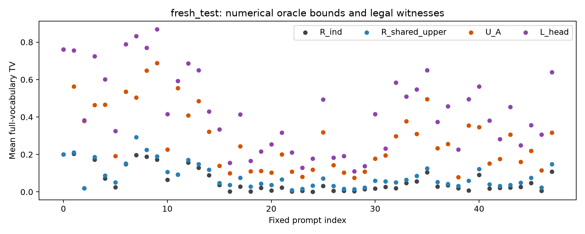
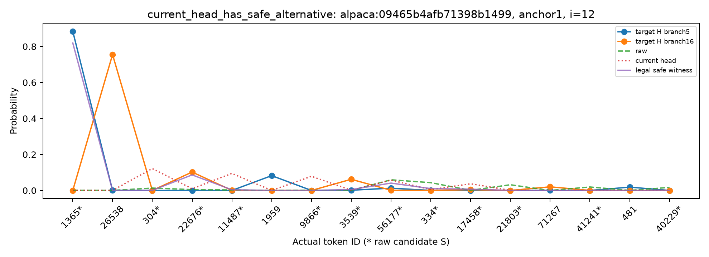
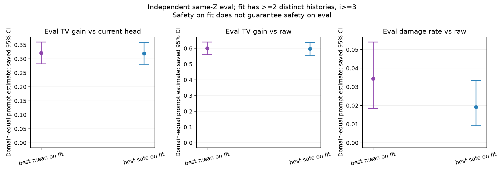
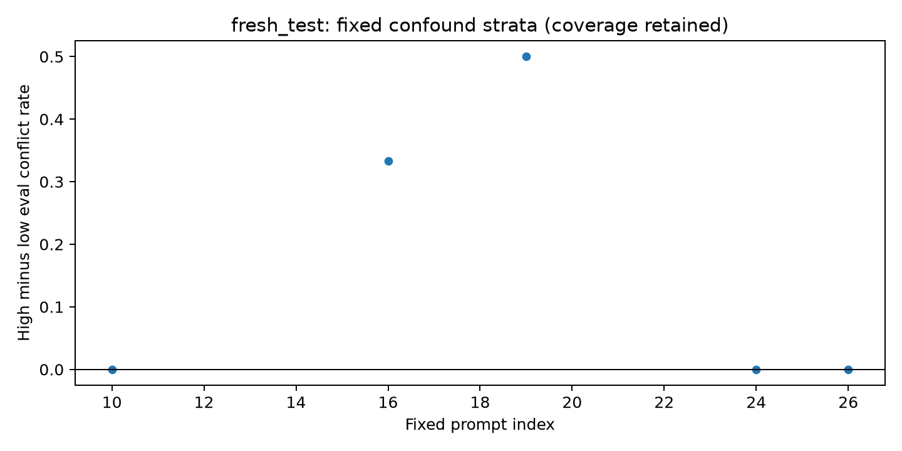
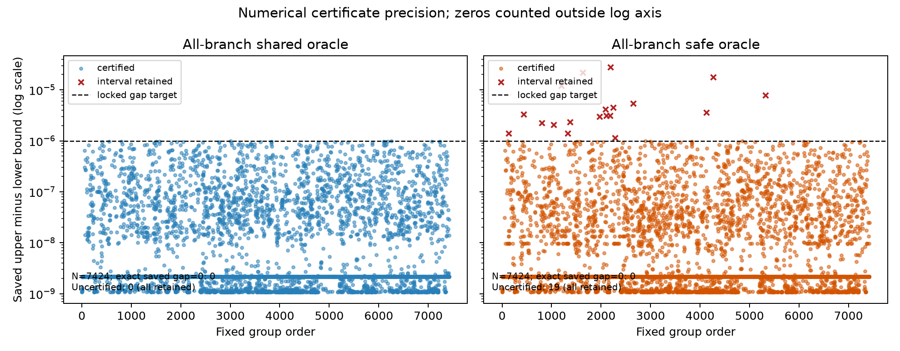

# ResidualV3 R4：失配与可修复性的有限组证据

本轮固定48题与全部核心分析已完成；没有训练新头或主体，没有重开RNG、统一剂量或吞吐实验。运行审计和最终资源账本见 `RUN_AUDIT.json`、根目录 `COMPLETION.json`。新增磁盘上限按用户后续授权为700 GiB，原科学LOCK保持原字节。

## 第一页：新增支持了什么、没支持什么

**什么能改善、为什么？** 在本轮自然target分支中，当前头可见的完整输入及完整输出相同，更早历史却不同。163个一好一坏组涉及38/48题；其中153组找到同一个真实basis/dose/BF16动作，使每条观察分支相对raw的TV都降低超过1e−5。因此，这些组的当前损伤不是输入碰撞强迫发生的。可改善的部分是允许操作内能共同调整的概率质量；同组目标不同，仍可能有共同改善空间。安全以raw为参照，不能泛称保住了当前头在每条原好分支上的全部收益。

**什么修不好、为什么？** 只改raw Top256时，尾部总质量可以变，内部条件比例保持。固定真实案例的两条raw TV同为约0.985，但逐状态放宽残差分别为0.101和0.798：后一条目标主要想输出候选外的“ Hub”，其尾部形状无法由这类操作单独重排。此外，共用一个动作相对逐历史动作有有限共享代价。本轮该代价均值约0.02346，95%题面区间[0.01932,0.02830]；这是指定集合、K32有限分支与自然频数的代价，不是一般信息论不可约率或失败的因果百分比。

**新证据是否只在看过标签的分支上成立？** 预定主要检验只用fit标签选动作，再用于独立eval同Z分支：相对当前头改善TV **0.319211**，97.5%区间 **[0.275986,0.363495]**；相对raw改善0.598183。覆盖GSM/Human/Alpaca为16/16/14题、1162个匹配核心组、5626条eval状态，不能扩称全部状态收益。fit安全也没有保证eval安全：相对raw的eval损伤率为1.918%，95%区间[0.912%,3.342%]。

**没支持什么、理论还缺什么？** 修复前对向残差C_g的未控制比较方向为正，但固定混杂分层后只覆盖4/0/1题，整体均值与区间不可定义。预设的双重确认未满足；不能写成新量已解释成败。实际操作全局最优未知，有限可行见证不能拆成纯容量或纯学习误差，也不能证明当前网络可以跨C学到这些动作。本轮没有新增native后果证据；仍缺target不可见时的成败规则、跨C可学习性及实际访问轨迹上的迁移。

**下一步是否值得做？** 值得做一项小的原头训练目标对照：检验多历史、raw参照的风险项能否学到本轮发现的部分共同余量。只作为建议，成本和反证条件见末节；本轮正常收束，不自动第五轮。标准TV公式、oracle优化和工程通过不是新理论贡献。

## 1. 证据身份与完整分母

新题来自原正式面板：GSM8K/HumanEval/Alpaca各16题，Alpaca使用正式500题面板；按锁定清单排除R1–R3、开发题及已知机制暴露。它们是本轮机制分析留出，不称从未参加项目评测、训练或预训练。完整规范化messages、token身份、来源行和seed见 `../protocol/SAMPLE_MANIFEST.json` 与暴露账本。资料阅读是五份既存一手版本的定向段落回查，不是新全面综述，见 [阅读记录](../sources/READING_RECORD_CN.md)。

每C固定K32，fit16/eval16独立seed池；自然采样允许历史重复。没有补采到碰撞出现，也没有删无碰撞题。48题共91个有效anchor；5个Alpaca的anchor65因EOS/短轨迹缺失，原原因与分母保留。采集43331个全位置状态、7424组；主量只用i≥3的37507条有效状态。i=1/2共231负控组，没有不同H、target逐位差异或异号冲突；其共享代价上界约1.08e−9，属于数值带内。

全部实际输入与完整q通过身份检查，排除组0，同输入输出TV最大差0。2358个i≥3组有不同H，涉及46题；其中163组异号，三域分别为GSM66/Human37/Alpaca60组。44365个不同H配对中2655个异号，仅是固定面板的未加权计数，不把配对或状态当独立统计样本。全部源见 `../analysis/INPUT_OUTPUT_IDENTITY_AUDIT.json`、`PHENOMENON_REPORT.json` 和原组表。

外层均值按域、prompt、有效anchor、有效位置等权，位置内保留自然存活分支频数。区间用锁定2000次按域分层prompt bootstrap。它不覆盖所有有限branch、求解与测度不确定性。所有匹配eval状态16303/18748；核心匹配5626/18748。未匹配不填0；下面主要迁移量是匹配条件部分，不是全体预期收益。

## 2. 操作范围、共享代价与当前未实现部分

R是只修改S内logits的放宽概率集合：r_S任意，r_U=t·q0(.|U)。标准闭式R_ind用完整U；R_shared要求观察分支共用一个R动作；R_safe再要求每条观察分支相对raw不恶化。真实操作A_ref还受冻结basis、hidden norm、dose及BF16算术限制。U_A只是有限已评价合法动作中的最佳损失，A_ref的全局最优未知。

以下均值范围为全部48题的i≥3有效状态；数值识别区间和题面统计区间是两回事。完整95%/97.5%区间及分域表见 [全部固定指标](METRIC_TABLES_CN.md)。

| 量 | 本轮值/数值边界 | 能解释到哪里 |
|---|---:|---|
| raw / 当前头TV | 0.703450 / 0.433360 | 基准身份，不作为本轮主要发现 |
| 放宽操作剩余R_ind | 0.059248 | 尾部条件形状不能任意重排 |
| R_shared | [0.082708958, 0.082709023] | 固定有限组共同动作下限 |
| R_shared−R_ind | [0.023461433, 0.023461498] | 指定集合下有限共享代价 |
| R_safe | [0.086127964, 0.086128033] | 保护每条观察分支相对raw的放宽参照 |
| 已找到合法/安全合法TV | 0.288249 / 0.290297 | 可行上界，不是实际集合最优 |
| 实际操作额外限制 | [0, 0.205540] | 同时含未识别的实际约束与见证搜索余量 |
| 当前头尚未实现部分 | [0.145111, 0.350651] | 至少有已找到的合法余量；不等于纯学习误差 |

最后两项由同一个未知A_shared耦合，不能各取端点相加成点分解或因果份额。当前已找到的合法改善下界0.145111，其95%题面区间[0.125044,0.166764]。这些数值不支持只用缺少更早历史来解释全部失败，也不证明条件失配在总体上不重要：K32有限分支和target-branch测度都限制外推。

1357个C/位置的候选basis矩阵数值秩均为256/256，条件数37.80–181.96。512维basis不能仅凭名称叫候选内低秩瓶颈；满行秩也不消除有限幅度、量化或优化限制。R2的几何预测增量负结果保留，本轮没有把这些谱值重新拟合成预测器。

图索引0–15为Alpaca、16–31为GSM8K、32–47为HumanEval；四条量是同一题面测度的参考值。这里的橙点是可行上界，不是实际可达最优。

## 3. 当前一好一坏是否必然：合法替代与真实案例

全部2358个不同H组中，2344组找到了逐分支严格改善raw超过1e−5的合法共同动作；163个异号组中153组如此。其余14个不同H组、其中10个异号组没有找到这种严格见证，不能判成不可修。所有固定候选、raw/current保留及逐分支损失见 `../analysis/FEASIBLE_WITNESSES.jsonl`（全7424组索引）。安全约束相对raw；有些安全动作仍可能减少当前头在原好分支上的收益。

三类案例按锁前字典序选择且避免组复用，均来自 `alpaca:09465b4afb71398b1499 / anchor1` 的商业机会描述题，各有fit1/eval1。**这些案例使用两池全部标签求见证，只是有限组描述；不能冒充主要fit≥2不同H的独立确认。** 类别也不是互斥的失配类型。完整H、概率图、尾部质量、dose、动作与证书见 [真实机制案例](MECHANISM_CASES_CN.md)。

第三例i=12/g68尤能说明误差大小与可修复范围的区别：

| 更早历史（两者前驱均为Living） | raw TV | 当前头TV | 逐状态放宽残差 | 共同合法见证TV |
|---|---:|---:|---:|---:|
| EcoLuxe Living | 0.984581 | 0.984764 | 0.101021 | 0.166232 |
| Eco-Smart Living | 0.985135 | 0.968146 | 0.797531 | 0.900374 |

前者target更偏向候选S内的“ –”（token1365），后者更偏向S外的“ Hub”（token26538）；目标尾部质量分别0.101438、0.804616。头没有区分更早的品牌历史，输出同一个q。后一条的大部分尾部形状误差即使逐状态放宽动作也消不掉，所以raw误差相近，允许的修正范围差很大。共同oracle约0.498909，逐状态均值约0.449276，仍有约0.04963的共享代价；但共同合法动作平均TV约0.533303，且两条都比raw、也比当前头改善。

本例当前坏分支损伤只有0.000183，不能拿它代表典型损伤幅度；它证明有限组中的可行替代与操作边界可以同时存在。逐状态残差直接复制原记录，token只作展示解码，没有重选案例或新求解，见 `../analysis/FIXED_CASE_FRONTIER_READING.json`。这不是跨题总体的误差匹配因果检验。

## 4. fit共同动作在独立eval分支上是否有效

主要量是fit≥2不同H、i≥3且eval匹配同Z的部分。只用fit选定一次动作，再评价同一个完整q；不重投影或按eval重选。

| 主要/对照量 | 域等权值 | 97.5%区间 | 定义题数GSM/Human/Alpaca |
|---|---:|---|---|
| fit安全候选相对当前头改善 | 0.319211 | [0.275986,0.363495] | 16/16/14 |
| fit安全候选相对raw改善 | 0.598183 | [0.552225,0.645548] | 16/16/14 |
| fit安全候选相对raw的eval损伤率 | 0.019182 | [0.008148,0.036000] | 16/16/14 |
| fit平均损失最小候选相对当前头改善 | 0.321039 | [0.277474,0.365705] | 16/16/14 |
| fit平均损失最小候选的eval损伤率 | 0.034438 | [0.016556,0.055866] | 16/16/14 |

“最小/最佳”仅指锁定有限候选集，不是TV全局最优。安全候选的分域头参照改善为GSM0.146682、Human0.357736、Alpaca0.453214。支持同C内有限共同动作的独立抽样迁移；不支持每个未来分支安全、每条eval历史都未出现、跨C新头可学、在线gate或实际接受收益已迁移。安全与平均候选的损伤率差仅作固定对照展示，没有新增差值显著性检验。

全部匹配（包括单fit历史）头参照改善0.111943，定义题数16/16/16；其条件权重与核心部分不同，不能混用。全体状态上的当前头恶化率0.110485同样不是核心eval候选损伤率的可直接相减基准，更不能和R3旧14.27%比作下降。

图用保存的95%区间；主结论使用上表预设97.5%区间。完整逐题分布见 `fresh_test_fit_eval.png`，全部分母见 `FIT_EVAL_REPORT.json`。

## 5. 修复前残差分歧是否解释冲突

C_g只用fit的修复前p−q0，不含q_head、修复后gain或gap。dev切点为low=0、high=0.000819449；raw TV、候选覆盖、位置和fit组大小的分层也保持锁定。

未控制高−低eval异号配对率差为0.104750，95%区间[0.027778,0.207101]，覆盖10/7/4题。高低组候选覆盖的简单描述约0.91265与0.96114，不能把未控制差当增量解释。固定混杂分层仅覆盖GSM4/Human0/Alpaca1题，整体估计和区间为NA。没有填0、改分箱、筛域或用未控制量替代主量。

H1的独立动作迁移得到支持；H2的控制后结构关系仍不确定，预设“两项各97.5%区间都为正”的双重确认未满足。覆盖不足不等于C_g无作用；本轮没有得到可靠的一般成败规则。target标签量也不能宣传为在线特征。

## 6. 证书、数值与研究边界

全7424组shared达到固定认证目标；7405组safe达到目标，19组保留区间。最大all-shared间隙9.85e−7，all-safe间隙2.81e−5；不加迭代救结果。全/fit四类共29696槽：25757份实际返回捕获、1份明确的事后闭式重构、3938个no-fit空槽；27个未认证区间（含fit）保留。原索引`actual_solve_proofs=25758`含那1份derived，不能读成全部实际捕获。5866份实际选用LP master的文件SHA已核查；闭式证明另列。详见 `ORACLE_CERTIFICATES.jsonl`、`ORACLE_CERTIFICATES_PROVENANCE_AUDIT.json`。

这批是带FP64 guard和可行容差的数值证据，不是有理数/定向舍入严格证明。65901个declared-safe候选的最大损伤9.69e−8，低于1e−7容差，不能叫数学严格零伤害。逐分支严格改善计数使用更大的锁定1e−5符号带。

实际GPU方向上的原BF16更新独立核验通过，最大FP64损失重构误差8.88e−16，完整尾部条件比例漂移2.68e−16，当前头复算TV差0。CPU重投影与GPU投影3487个动作逐位不同，最大输出TV差0.046242；它是不同后端产生的不同动作，不能并入FP32/FP64归约漂移、替换实际GPU动作或用来放大符号带。有限已评价动作的概率漂移不认证整个未搜索A32集合。

本轮测度是自然target-branch，不是native/reached-prefix。理想单状态接受与TV的标准关系不自动给出真实连续存活或每轮接受；本轮不使用普通路径overlap乘积，也不报告服务TPS。R1条件KL主导未证、R2几何量增量未支持、R3统一半强度不优及原`NATIVE_BRIDGE_AUDIT.json passed=false`都保留，新结果不覆盖旧警报。资料、源码与概率边界见 [理论卡片](THEORY_CARDS_CN.md)、[测度与动作合同](METHODS_CN.md)、[资源偏差记录](RESOURCE_HISTORY_CN.md)。

## 7. 唯一下一项方法建议（未执行）

只检验**原头训练目标加入同Z多历史的raw参照风险项**，不加结构或更长历史输入，不搜索统一剂量。由153个异号组存在真实安全替代、且fit共同动作能迁移但仍有eval损伤这两项发现驱动。冻结联合主体，原头同初始化/训练数据/计算量对照；风险项λ仅预设0/1，不用本轮留出作训练或调参。它是目标对照，不预称新算法或必然可学。

建议小pilot上限：单卡6 GPU小时（含新标签、训练、评估及最多1小时native后果检查），CPU8小时、新增磁盘30 GiB；规模和统计需下一任务锁前定案，估计不是本轮实测训练成本。反证条件：只降低坏状态率却不改善新留出平均TV，或实际每验证轮发出的accepted proposal无可信改善，都不足以推荐方法；跨C泛化失败则收缩可学习性主张。原native机械身份仍需核验，经验计数不解除理想概率警报。**本轮不启动此建议，不用剩余预算加训，不自动第五轮。**

最终主张与证据逐项见 `CLAIM_EVIDENCE.json`。核心实验完成与资源偏差分别记账，工程完成不是理论创新。
