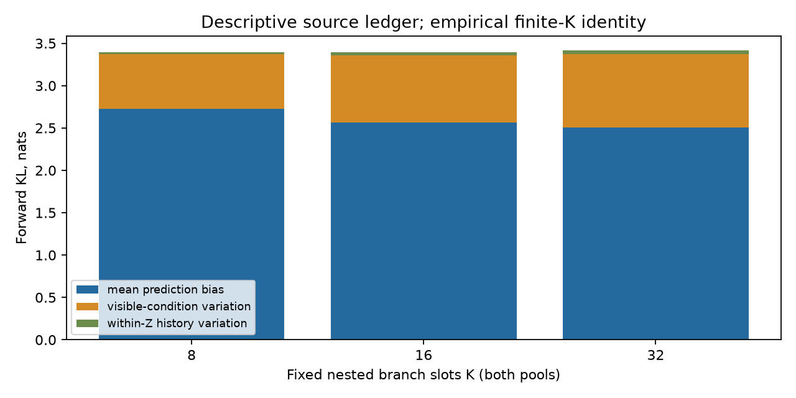
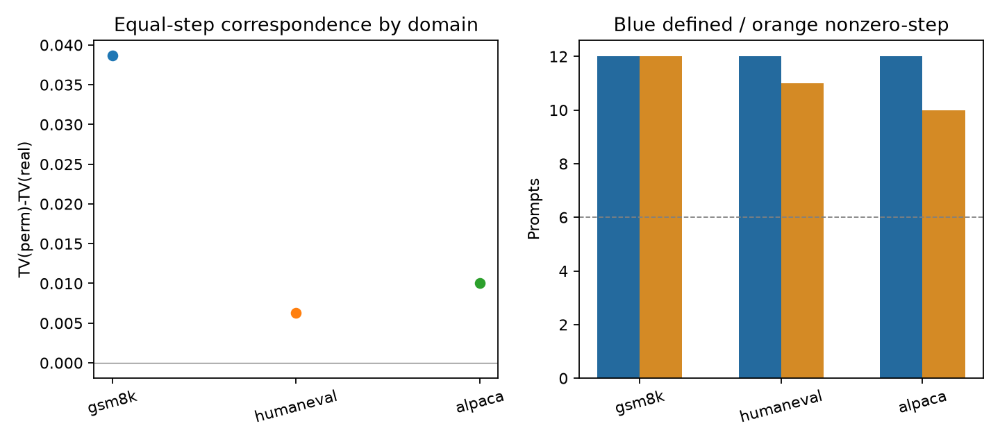
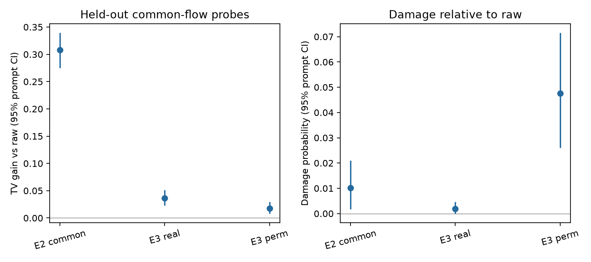
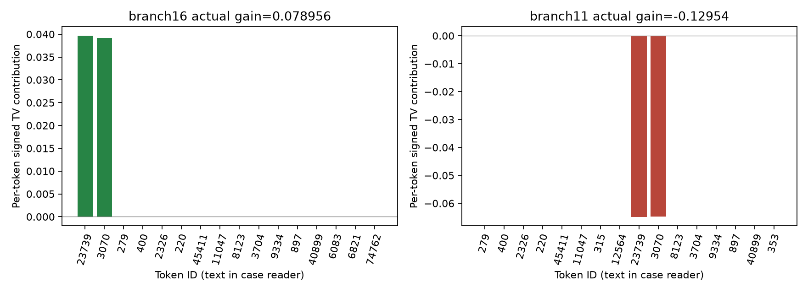

# ResidualV3 R5：哪些失配允许共同修正，为什么同一动作一好一坏

本轮完成固定36条新机制题的E1–E4分析。研究工具是冻结E2联合主体和原头；没有训练、结构/输入/损失改动、LP、新见证优化、native、RNG、吞吐或剂量搜索。旧18题只读开发，新36题独立汇总；旧报告与警报保留。

## 第一页：五个问题的直接回答

**失配从哪里来？〔经验描述已支持；参数起因未知〕** 同一个上下文上的raw预测，既偏离自然历史的平均target，也不能随每条历史改变。新题K32的平均预测偏差、可见条件变化、同Z内历史变化分别为2.50766、0.86349、0.04248 nats。这是有限样本结构账本，不是容量/训练原因分解，也没有重新证明条件项主导。本面板平均较小的同Z历史项仍可在个别状态翻转修正方向，下面的真实“calculate/find”案例直接展示了这一点。

**什么偏差能够共同修、为什么？〔H_shared已支持，限预定子集〕** 不同历史中持续共同低估、共同高估的概率质量，确实有一部分可迁移到独立抽样分支。只用fit构造固定全词表探针，在匹配eval上降低TV **0.307773**，97.5%题面区间 **[0.270310,0.343946]**，三域各12题有定义。加权eval损伤率仍为 **1.021%**，不是未来分支安全保证。fit改善本身由构造保证，未计作发现。

**正确的条件对应有什么用？〔H_match已支持，作用范围有限〕** 同样多的fit分支、同样搬运幅度下，真实分组相对同C内置乱平均再降低TV **0.018342**，97.5%区间 **[0.007513,0.031062]**；有非零配对步长的题数为GSM12/Human11/Alpaca10。它支持这套方向的对应价值，既不是前驱全部信息价值，也不是条件失配的因果份额或一般主导结论。

**原头何时失败？〔固定状态的概率解释已支持〕** 在同C、完整Z及完整q相同的真实分支上，目标可能要求相反移动。计算125立方根的案例中，原头把“ cube”从0.16443推到0.29410：“ calculate the”分支需要0.26894，因而受益；“ find the”分支只需0.07586，因而反向受损。失败也可来自fit共同偏差在eval消失；操作外尾部形状则构成另一种剩余限制。不能把所有失败统称为剂量过量、缺前驱或不可修。

**还分不清什么？〔不确定〕** 探针允许改变完整词表，不是当前头合法动作；它成功不证明原头可达或实际利用了同一方向。主量只覆盖1034/3255条主位置eval状态；其中862条历史曾在fit出现，172条未出现，独立seed不等于全新历史。容量、训练、优化的具体原因、无target时的判断规则、真实连续接受后果仍未识别。旧R2概率警报未解除；不从本轮TV推导AC/TPS。本轮可以收束，不自动训练或开启第六轮。

## 1. 数据、测度与全部分母

新题来自原正式GSM200题、HumanEval164题和Alpaca500题面板，各12条。合并发现的R1–R4机制清单及专家/headonly清单后，候选剩余88/52/462条；按原定规范化SHA排序和固定seed抽取，精确机制暴露重合为0。检查的834998条训练元数据中未记录到本次精确匹配；这不排除语义、主体训练或target预训练重合。它们是新的机制分析留出，不是从未用于项目评测的数据。完整messages/token与来源版本见[样本清单](../protocol/SAMPLE_MANIFEST.json)、[暴露账本](../protocol/EXPOSURE_LEDGER.json)。

每C自然K32，fit16/eval16独立seed槽；生成全部15个中间位置，保存1/2/3/8/15，主分析仅3/8/15。anchor1/65沿原HF target轨迹，T1完整词表、原EOS151645，不截断prompt，不补采到碰撞。四条Alpaca缺anchor65，保留原EOS/短轨迹原因。这里是target分支到i仍存活的测度，不是native实际reached-prefix。

| 分母 | 新36题数量 | 范围 |
|---|---:|---|
| 有效anchor / 预定anchor | 68 / 72 | 缺失4个，不补齐 |
| 全部保存状态 / 同Z组 | 10854 / 1363 | 含1/2负控 |
| 主位置状态，fit / eval | 6502，3247 / 3255 | 自然存活频数 |
| fit≥2不同H组 / 无匹配eval | 225 / 31 | 资格仅由fit确定 |
| 匹配核心组 / eval状态 | 194 / 1034 | 主量条件子集，非全体收益 |
| 核心M=0组 | 15 / 194 | 固定零带，保留raw和零效果 |
| 有任一次非零配对步长组 | 70 / 194 | 其余124组的8次均零 |
| 非零配对 / 全部配对 | 245 / 1552 | 不删零；未加权原始计数 |
| 核心eval历史在fit已见 / 未见 | 862 / 172 | 保留自然重复，不另做未预定子检验 |
| 主位置不同H组 / 原头异号组 | 387 / 26 | 描述计数，不当独立样本 |

Z检查涵盖全部实际输入张量及完整输出，不能仅凭候选hash、dose或前驱ID分组；没有发现相同完整Z被人为拆成不同前驱组，完整同Z输出差为0。target的uint16按BF16位恢复，原头从实际GPU候选更新与未改raw尾部重构，未用CPU重投影替换。见[身份和测度审计](../analysis/IDENTITY_AND_MEASURE_AUDIT.json)。

主统计保留组内自然eval频数；题内有定义主位置和有效anchor等权，域内题面等权，三域等权。区间为2000次按域分层的整题bootstrap，分支和8次置乱不作独立样本；条件于这次分支与固定置乱实现，不额外覆盖它们的Monte Carlo误差。未定义不填0。科学锁在新题效果打开前形成，只有一次fresh打开；规则见[方法](METHODS_CN.md)与[LOCK](../protocol/LOCK.json)。

## 2. E1：平均偏差与历史变化共存，账本不识别训练原因

固定C后，raw q0不随块内H改变。mC是自然历史的平均target，mZ再按完整可见输入分组；pH−q0可拆成平均偏差、条件均值变化及组内历史残差。下表使用同一经验自然权重，单位为nats。

| 预定嵌套K | 总forward KL | 平均预测偏差 | 可见条件变化 | 同Z内历史变化 |
|---|---:|---:|---:|---:|
| 8 | 3.394566 | 2.725498 | 0.645608 | 0.023459 |
| 16 | 3.391420 | 2.565344 | 0.793793 | 0.032284 |
| 32 | 3.413624 | 2.507656 | 0.863485 | 0.042483 |

K增大时经验均值与分组同时变化，历史项也改变。等式精确不代表总体无偏估计；不把本表改写为主导定理、TV收益分解或容量因果比例。q0也没有被假定为精确target边缘。i1两项历史变化为零，i2同Z内历史项为零的负控均通过；i2可见条件项允许非零。

均值/分组恒等式属于已有工具：Banerjee等的Proposition 1与Theorem 1组合后得到这里的forward-KL特例，见[一手核验范围](../sources/R5_READING_CN.md)。近邻也已讨论并行边缘与实际历史条件的差异，本轮不声称首次发现该问题。新增证据来自后面的固定留出与真实状态，而不是公式成立。

## 3. E2：持续的共同同向偏差可以迁移，但不是每条历史安全

探针只用同Z的fit目标，取逐token共同低估u、共同高估o，搬运固定质量M/2。每条fit分支TV改善M/2是数学构造；完整r先冻结保存，再读eval损失。它没有训练参数、没有搜索额外剂量，也不是R3的头dose减半。

| 预定量 | 域等权值 | 区间 | 解释 |
|---|---:|---|---|
| eval TV改善 | 0.307773 | 97.5% [0.270310,0.343946] | H_shared通过预定效应及覆盖门槛 |
| eval受损比例 | 1.0213% | 95% [0.1687%,2.1044%] | gain<−1e−5，仍有反例 |
| eval负向TV幅度 | 0.0001872 | 95% [0.0000051,0.0005174] | 对全部合格状态平均max(−gain,0) |
| eval改善比例 | 91.852% | 95% [87.331%,95.804%] | gain>1e−5，零及中性保留 |

分域改善为GSM0.331799、Human0.318445、Alpaca0.273076，各12题有定义。主量1034条eval中有大量自然重复历史，所以结论是独立抽样分支风险的迁移；不能称每条历史均未见或跨C学得了规则。原始各组M、fit/eval行号、全部r及其SHA见[FIT_PROBE_ARTIFACTS](../analysis/FIT_PROBE_ARTIFACTS.json)与[HELDOUT_COMMON_FLOW](../analysis/HELDOUT_COMMON_FLOW.json)。

**共同改善的真实例子。** 固定字典序第二例是“Calculate the cube root of 125.”，anchor1/i8。fit含“ calculate the **cube root of ”及“ find the **cube root of ”两种H；二者接下来复述125时，都几乎必然输出首token“1”（不是立方根答案）。raw只给0.725519，fit共同方向把它提高到0.862759，eval仍需要约1，因此TV改善0.137241。原头把它提高到0.999957，也与这个方向相容。这里只支持该状态的同向解释，不能由此把探针全部收益归给原头。

**fit同向却在eval受损的真实反例。** “Describe a place where you feel most at peace”，anchor65/i8，前驱同为“ in”。两条fit分别为“ large, comfortable armchair sits in”和“ large, soft armchair sits in”，需要“ the”的概率至少0.777095；raw为0.082905，探针提高到0.430000。独立eval却是“ large window on one side lets in”，target对“ the”仅0.042045，更需要“ soft”（0.844506）。探针沿原fit方向提高前者、降低后者，该eval的净TV反而恶化0.068103。另一条eval改善，所以该组均值仍正0.154468；这正说明平均有益会掩盖局部损伤，不能删掉坏分支。

两例都是锁前类别规则下的说明性选例，不估计语义类型流行率。完整前文、fit历史、p/q/r及每token贡献见[案例读本](MECHANISM_CASES_CN.md)。有益例中的独立eval历史可能重复，也不掩盖这一点。

不按Z的C合并探针有描述性改善0.044071，95%区间[0.030027,0.059493]，与某些跨历史共同偏差相容。但其样本数、资格和M不同，不能拿它与0.307773直接相减或排名。M=0也只表示这个充分构造不动作；补偿式共同改善的CPU反例保留，不能判不可修。

## 4. E3：控制搬运幅度后，条件对应仍有有限价值

8次固定置乱只在同C/i中交换fit的Z标签，保留target多重集与每组样本量。每次双方使用min(Mreal,Mperm)/2，在完全相同的真实eval上评价。任一M为零双方都raw；同C只有一个Z时允许同方向、同动作及零差。不能按对照是否有效另挑置乱。

| 域 | E2改善 | E3真实相对置乱改善 | 有定义题 | 含非零配对步长题 |
|---|---:|---:|---:|---:|
| GSM8K | 0.331799 | 0.038653 | 12 | 12 |
| HumanEval | 0.318445 | 0.006323 | 12 | 11 |
| Alpaca | 0.273076 | 0.010051 | 12 | 10 |
| 三域等权 | 0.307773 | **0.018342** | 36 | 33 |

E3预定97.5%区间[0.007513,0.031062]且三域覆盖门槛满足，H_match在预定范围内得到支持。非零配对的加权频率为17.029%，原始245/1552配对非零；两个口径不同，均保留零动作。非零步长不保证两方向不同，单Z的零差也保留。它表明此处效果不能全部由分组样本量较少或调整更大解释；不识别前驱的完整信息价值、语义干预或条件失配的总体份额，也没有已知实质阈值可据此宣称重要突破。

配对真实臂相对raw改善0.036083，置乱臂改善0.017741，差即0.018342。两臂各自相对raw的加权损伤率为0.186%和4.764%，均为描述量；“先平均8次差再判负”的主差损伤率本次为0，负向幅度约4.87e−10。样本bootstrap的[0,0]不能证明总体无损，两臂也不等于对raw零损伤。

图中为95%区间，主判据使用上文97.5%区间。**E2与E3两臂的步长不同，三列不是算法排名；只比较同一E3配对。** E3各固定置乱的域等权主差依次为0.013042、0.013466、0.014192、0.045222、0.022959、0.019896、0.004560、0.013402；固定8次先平均，不选最好次数、不当8个独立实验。

位置覆盖也不均衡：i3/8/15的核心组为16/76/102，eval为197/435/402；GSM的i3没有合格组，不能填零或推出该位置有效。i8和i15各自条件化后的描述均值见[完整指标和分层表](METRIC_TABLES_CN.md)，不把它们的均值拼成另一主量，不从组大小表重新挑子集。

## 5. E4：同一修正一好一坏的具体概率原因

全部主位置6502条状态上，raw/原头TV为0.651365/0.422510，改善0.228855；加权受损率13.328%，95%区间[10.243%,16.805%]。这是fit+eval全部主状态的描述，与E2的核心eval人群不同，不能把13.328%与1.021%相减或作方法优劣比较。387个不同H组中，26个原头一好一坏；完整输入及完整q相同已核验。

**固定首例：“calculate”与“find”留下不同目标，头看到的前驱却相同。** 题面仍是125立方根，anchor1/i3。下表中的q0与qh两支逐位相同；H、p不同，前驱均为“ the”。

| token / 量 | 两支共同raw q | 两支共同head q | H=“ calculate the”的p | H=“ find the”的p |
|---|---:|---:|---:|---:|
| “ cube” | 0.164429 | 0.294097 | 0.268941 | 0.075857 |
| “ **” | 0.835038 | 0.705501 | 0.731057 | 0.924133 |
| raw TV | — | — | 0.104512 | 0.089097 |
| head TV | — | — | 0.025556 | 0.218638 |
| 实际改善 | — | — | **+0.078956** | **−0.129541** |

“ cube”的平均残差是+0.098478，但find分支的组内历史残差为−0.187050，翻转了实际需要的方向。提高“ cube”、降低“ **”帮助calculate，却同时反向伤害find。calculate上两处都略越过target，仍各有正贡献；find上这两处分别贡献−0.064834、−0.064768，几乎构成净损伤。不能只凭越界判坏，更不能把这例归成单纯剂量过大：坏分支从一开始方向就相反。

这两条的尾部闭式剩余仅约5.75e−10与2.07e−9，本例损伤不能用候选外尾部形状来解释。它也不证明任何共同动作都必然伤害一支；本轮没有为新状态搜索合法替代。R4已找到153/163个旧异号组的合法共同改善raw动作，原结论不变。

全词表账本的平均正贡献0.355223、负贡献幅度0.126369，抵消后才是0.228855。按实际移动分类如下；这是所有主状态的事后账本，不是“坏状态原因占比”。

| 移动类别 | 正贡献均值 | 负贡献幅度均值 |
|---|---:|---:|
| 朝target且未越界 | 0.346161 | 0 |
| 越界但仍改善 | 0.009062 | 0 |
| 越界致损 | 0 | 0.008978 |
| 反向或离开原一致 | 0 | 0.117391 |
| 零动作/中性 | 0 | 0 |

这批数据的负坐标贡献更多记在反向移动，不能把整体损伤重命名为“过量修正”。账本只定位已经发生的概率变化，不识别为何网络产生它，更不回归gain对自身组成项制造解释率。

**操作范围是另一条边界。** 只改raw Top256时，尾部总质量可变，但尾部内部比例保持。完整尾部闭式剩余平均0.075095，95%区间[0.053748,0.098370]；这是指定放宽集合的限制，不是任意头的极限。固定尾部案例第一例下限仅1.90e−5，第二例为0.383414；没有为了讲故事换成更大的例子。后者仍有head净改善，说明存在剩余限制不等于当前动作必然失败。全词表探针可改变这部分形状，不能冒充真实头合法动作。

## 6. 已知工具、新证据与未知边界分开

已知层：KL均值/分组、TV逐token账本及固定共同质量流的fit保证，连同小词表反例，是数学工具。近邻已有边缘/条件差异与前驱修正认识；本轮没有文献优先权或跨论文性能排名主张。版本和实际页段见[来源记录](../sources/R5_READING_RECORD.json)、[理论卡片](THEORY_CARDS_CN.md)。

新证据层：在预先排除机制暴露的新题中，指定共同同向偏差在独立分支抽样上可以迁移；等样本量、等搬运幅度后，真实条件对应保留有限增量；完整概率案例把平均偏差、隐藏历史反向需求和实际错误移动联系起来。这不是“输入有用”的结构消融，也不是一般mismatch理论已经完成。

未知层：共同同向只是可修的充分形状，不覆盖所有补偿式共同改善；M=0和探针失败都不能判不可修。有限K、同Z匹配、EOS存活条件及大量重复历史限制外推。原头实际操作最优、未实现部分中的容量/训练/优化归因、target不可见时的判断、真实native连续后果均未建立。E1中同Z历史项平均较小，不排除局部方向翻转；E3正结果也不撤销R1条件主导未证、R2几何增量未支持、R3统一半强度不优、R4一般解释增量未确认。

旧18题的开发结果为E2改善0.296549、E3改善0.020197，均只作探索；其Alpaca有定义5/6，E3非零步长覆盖6/5/4，不作为本轮确认，也没有按其效果调整K、位置、阈值或探针。见[开发汇总](../analysis/SUMMARY_dev.json)。新36题两项分别通过预定检验，不合成为一般理论“联合通过”章。

## 7. 数值、资源与归档

新题最大KL身份误差7.30e−15、fit收益身份误差5.56e−16、E4账本误差6.67e−16，远小于锁定1e−10；实际BF16分布重构与保存标量差≤5.56e−16。原GPU FP32 buffer相对FP64参考的最大TV差分别为p1.21e−7、q0 4.86e−7、qh 5.39e−7；FP32和误差最大1.08e−6单列，没有静默归一化或用CPU重算冒充实际buffer。完整尾部保留，尾部条件比例漂移≤8.47e−16。

36题采集只启动一次，累计 **0.367713/8 GPU小时**，共卡自有显存峰值21768MiB；不报告共卡TPS。CPU和新增磁盘上限为24小时、700GiB，最终累计及保守写入上界见[运行审计](RUN_AUDIT.json)与[COMPLETION](../COMPLETION.json)。核心数值入口均限制线程；锁前一条元数据import缺少完整线程观测，不能宣称全run线程审计无条件通过。恢复、账本口径及这一记录缺口见[资源历史](RESOURCE_HISTORY_CN.md)。

旧签名结果与实际复用数据SHA核验通过；201项冻结来源复核SHA、23项大型资产复核stat，未伪称重新hash所有大权重。R2原NATIVE_BRIDGE_AUDIT的passed=false及R4资源/事后证书披露未改，见[旧资产保留审计](../analysis/FINAL_PRIOR_PRESERVATION_AUDIT.json)。最终自有身份退出和共享预约释放另由宿主审计确认。科学完成、数据身份和资源记录范围分别记账。

所有主张及反证边界见[claim–evidence](CLAIM_EVIDENCE.json)，全部数值见[完整表](METRIC_TABLES_CN.md)，真实前文与概率见[案例读本](MECHANISM_CASES_CN.md)。本轮按授权正常收束；不承接R4训练建议，不追加剂量、优化、native或第六轮。
