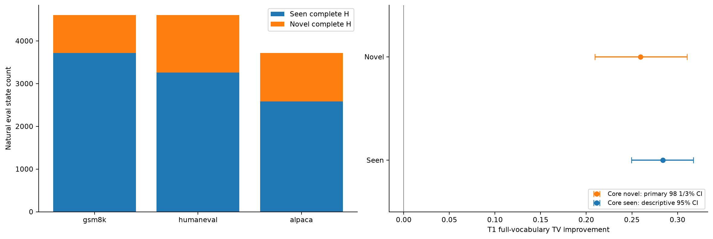
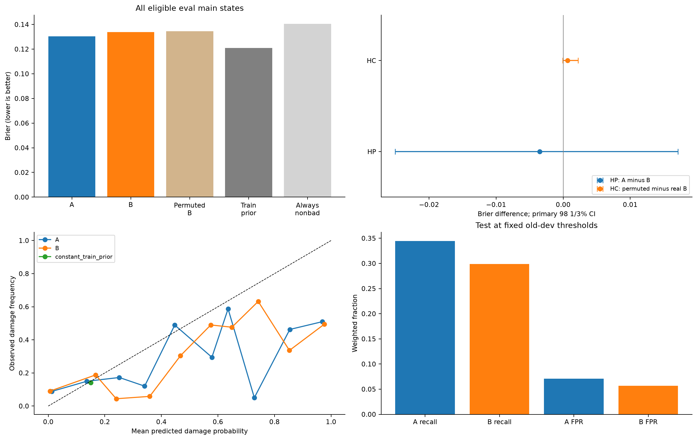
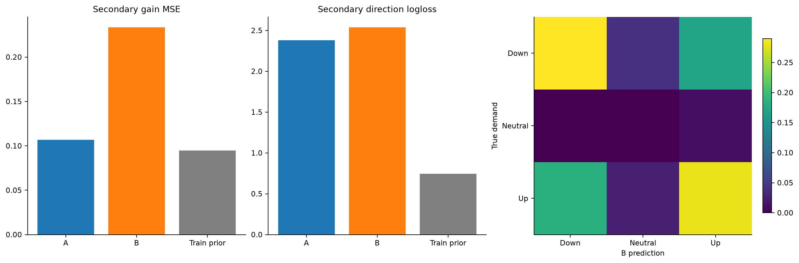
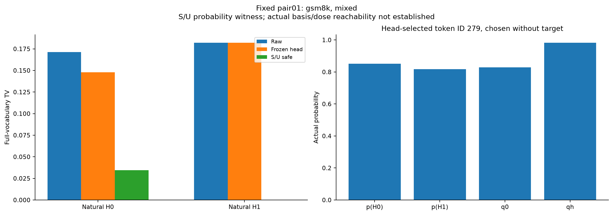

# R6：历史、失配与原头修复成败

本轮固定48题全部采集与分析完成，T1–T4各自结论如下，不合成一般理论总通过。工程与资源审计见文末和RUN_AUDIT。

**未见历史还能共同修吗？** 已支持：预定novel核心集合TV改善0.259371，98⅓% CI [0.209580, 0.310423]，覆盖准入=True。该子集共868个自然状态、44题；域等权损伤率约2.77%，所以平均有效不等于每条历史都改善。

**历史能提前判断原头修坏吗？** HP为-0.003487（[-0.025034, 0.017127]，不确定）；HC为0.000676（[-0.000080, 0.002235]，不确定）。两项未同时满足，不能声称已确认“新增历史及正确分支对应都提高风险预测”。有限模型的负结果不等于历史没有信息。B Brier=0.133765，训练先验常数=0.120934；B未胜过常数，不包装成可用风险识别。 HP>0表示加入更早历史后损伤概率的预测误差更小；HC>0表示正确的历史对应比同Z内打乱对应更好。

**能判断需求方向吗？** 次要描述：A/B方向logloss=2.381353/2.539218，常数=0.744102（越小越好）。两个固定模型的点估计均未优于常数，不包装成有用方向识别。方向预测不等于整体修好，不替代HP/HC。

**原头失败后还有兼顾空间吗？** 固定12对中，safe松弛候选让两支均严格改善raw的有11对。仅证明这些有限对的S/U松弛集合有空间；未证明原basis/dose可达。

**还不知道什么？** 本轮不识别原头的纯容量、训练或优化起因，不证明历史充分，不得到最佳修复动作或可部署gate。T1用了fit target标签且允许全词表动作；T4只诊断松弛集合；T3固定ridge B达到1000次上限未证收敛。未做native，R2原概率警报passed=false和R1–R5负结果/资源披露保留。不自动开启第七轮。

## 1. 失配的科学对象

固定C与原头完整Z时，q0及qh相同，target p_H仍可随更早历史改变。条件平均偏差与历史残差的标准分解只界定对象，不是TV收益分解或新理论。这里区分三个证据：共同方向的未见H稳定性、不读当前位置target的风险/方向可提取性、失败分支中的有限共同空间。三者不能互相替代。

R4旧fresh48训练(8642状态)、R5旧fresh36开发(6502状态)、本轮48题测试(12937个eval主状态)，按完整题面隔离。独立seed不是novel；本轮按同C/i全部fit完整H判定。新题机制未暴露不代表没有参加过项目正式评测或模型训练。

## 2. 三项固定主检验

|主量|估计|98⅓% CI|覆盖准入|判定|
|---|---:|---|---|---|
|HN|0.259371|[0.209580, 0.310423]|True|已支持|
|HP|-0.003487|[-0.025034, 0.017127]|True|不确定|
|HC|0.000676|[-0.000080, 0.002235]|True|不确定|

HN只在预定fit含至少两种H且匹配Z的novel子集上定义；HP/HC保留全部合格eval主状态，包括seen、未匹配、单历史及零置乱差组。覆盖只用于支持判定，不重选点估计人群。98⅓% CI是2000次域分层整题bootstrap的固定分位，条件于本轮模型/分支/置乱，不覆盖训练seed不确定性。完整95%描述区间、分域、零动作与无定义分母见[完整统计表](METRIC_TABLES_CN.md)。

## 3. 风险识别必须看基线、检出和校准

原头全部主状态的域等权raw/head TV为0.655815/0.459671；损伤比例=0.140604。全预测非坏准确率=0.859396，因此高accuracy不能证明识别损伤。

|模型|Brier|AP|固定dev阈值test recall|test FPR|ECE10|
|---|---:|---:|---:|---:|---:|
|A|0.130277|0.365345|0.344701|0.070741|0.111963|
|B|0.133765|0.348980|0.298912|0.056949|0.123016|
|constant_train_prior|0.120934|0.140604|0.000000|0.000000|0.009965|
|always_nonbad|0.140604|0.140604|0.000000|0.000000|0.140604|

阈值只在旧dev按FPR≤10%选定；test FPR可改变，不重新调为10%。常数基线与不报警对照不是上线策略。同一冻结B按精确C/i/Z交换完整历史块的预测，再逐次算损失平均，未用“先均值预测”获得集成效应。8次变化范围、分类区间及NA比例完整保留。A/B独立拟合且参数不同，因此HP与HC分开解释。

## 4. 次要收益与单token需求方向

次要描述：A/B方向logloss=2.381353/2.539218，常数=0.744102（越小越好）。两个固定模型的点估计均未优于常数，不包装成有用方向识别。方向预测不等于整体修好，不替代HP/HC。

收益MSE A/B/常数=0.106768/0.233634/0.094689。
方向token仅由q0/qh最大概率移动预选，不用p或真实当前位置采样token挑选。完整类覆盖、混淆矩阵、clip次数和分域结果均给出；训练三类存在。固定训练轮数不是收敛保证，ridge B stop7未救跑。方向需求正确也可能过量或在其他token受损，不能据方向表现宣称修复收益。

## 5. 真实同Z自然分支及有限共同空间

固定12对中，safe松弛候选让两支均严格改善raw的有11对。仅证明这些有限对的S/U松弛集合有空间；未证明原basis/dose可达。

每域混合标签与非混合标签各固定最多2对，按更早H汉明距1优先再字典序，全部选中对和无例情况保留。不按效应大小换案例。每对真实p/q0/qh、逐token正负TV账本、R_ind、R_shared、R_safe和实际返回的primal/dual见[机制案例](MECHANISM_CASES_CN.md)及原始npz。

固定pair01中，同一原头把“ the”的概率从0.828312提高到0.983175，而两条历史的target需求分别是0.851952与0.817574。该token在两支都造成损伤；其余token约0.077354的共同改善足以补偿第一支，却不足以补偿第二支，得到总TV一好一坏。safe松弛另有两支共同严格改善，说明当前失败并非这个松弛集合内的必然冲突。固定pair02则需求同向但幅度不同，同一提高对一支有利、对另一支越过target。两对完整账本见[固定前两对解释](FIXED_CASE_INTERPRETATION_CN.md)；自然历史不是语义因果干预，账本不识别训练/容量原因。

safe是相对raw不伤害各支的数值约束，容差≤1e−7不能叫精确零损伤。只有实际候选逐支改善>1e−5才计共同严格改善；不由均值最优推断。求解未证保留上下界，不叫不可修。松弛动作可行不能推出原头basis/dose可达。

## 6. 结论能解释到哪里

共同偏差可能在同C/Z的新H上稳定，也可能随历史反向；本轮用HN检验前者，用不读当前位置target的固定风险/方向预测器检验可提取性，用T4检验有限剩余空间。标签参与的诊断、事前预测和实际可执行修复分开。固定预测器成功不证明原头确因缺历史而失败；有限模型负结果不证明历史无信息。

R5标签参与的共同方向/条件对应、R4合法动作见证、R1条件主导未证、R2几何增量未支持、R3统一半强度不优均保留各自测度和边界；不能跨轮数字排名。Hewitt/Liang控制任务与本轮同B历史对应置乱不同；Voita/Titov的MDL工具本轮未执行，不据标准公式、控制通过或参数量声称新理论。见[理论卡片](THEORY_CARDS_CN.md)、[定向原文阅读记录](../sources/R6_READING_CN.md)。

## 7. 执行与资源边界

模型锁先于新题采集；特征worker和预测worker拒读fresh标签，全部预测与8次置乱索引签名后才运行标签入口。三域各16题固定K64，没有按novel覆盖、冲突或效果补题；完整Z与完整q核验，而非只比token/dose/hash近似。实际BF16保存头输出用于完整词表概率身份。详见[方法](METHODS_CN.md)、[身份审计](../analysis/IDENTITY_AUDIT.json)、[访问审计](../analysis/FEATURE_ACCESS_AUDIT.json)、[模型锁](../protocol/MODEL_LOCK.json)。

GPU按实时显存及预约允许共卡，只用1卡，不要求空卡，不报告TPS。启动/采集/失败/等待均进入新轮预算；CPU数值库import前单线程，Torch intra/inter1，驱动/IO线程单列。最终GPU/CPU/磁盘账与自有进程退出、共享lease释放见RUN_AUDIT和COMPLETION。旧资产只读，全run静态SHA及收尾例外分别签名；大权重本轮stat+继承哈希，不伪称新全量SHA。

交付到此结束，不自动扩特征、换模型、训练头或开始第七轮。必要工作完成与科学支持分开；覆盖不足或科学负结果可以正常complete。

采集曾因执行会话外部中断退出，旧阶段0.3256756667296092 GPU小时仍计总账；29个已完成上下文核SHA后保留，只续采缺失部分。未改变科学代码/清单/seed，未读效果后补样；中断与恢复日志完整归档。

锁定模型的训练/开发泛化差距及原始有限迭代见[模型卡片](MODEL_CARD_CN.md)。
