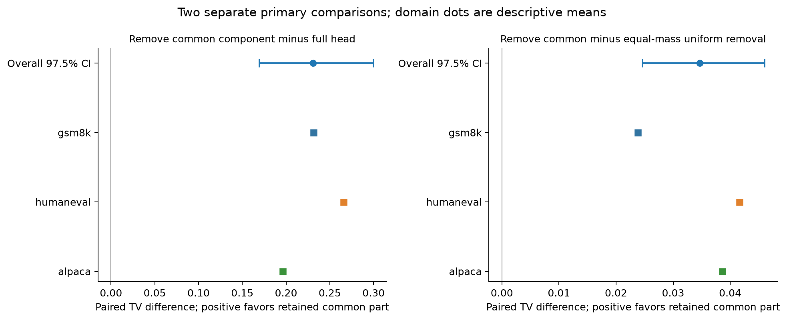
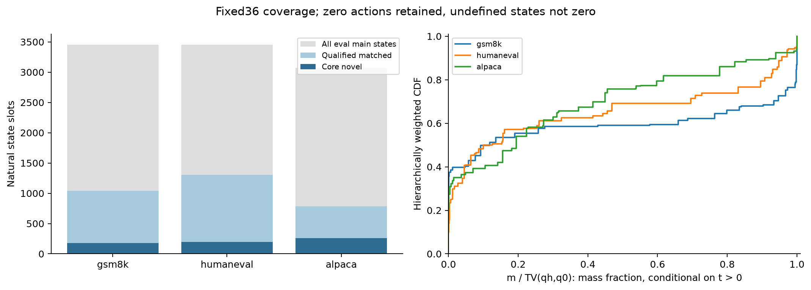
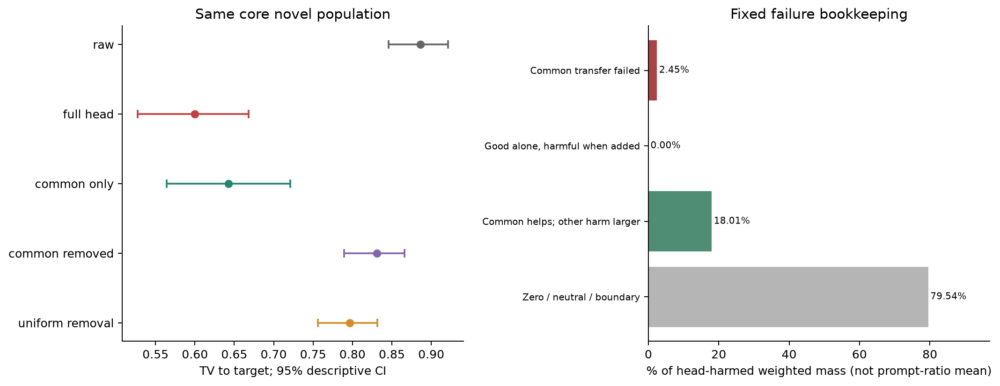
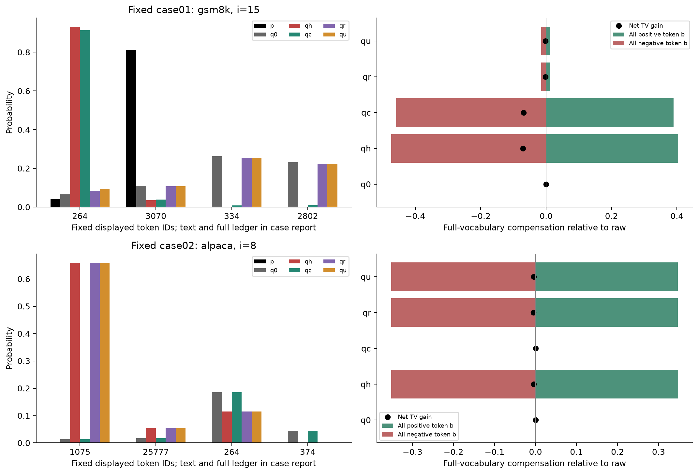

# R7：共同失配是否对应原头实际收益

**原头共同部分是否有用？** η=0.231033，97.5% CI [0.169614, 0.299938]；已支持。它比较移除共同部分与完整头，η>0才表示保留它对完整动作有正边际价值。

**是否超过同质量对照？** κ=0.034657，97.5% CI [0.024605, 0.045998]；已支持。本轮两项各自通过固定覆盖与97.5%区间判据：共同失配与原头实际动作之间存在这条有限联系。

**何时仍会失败？** 核心novel集合原头受损加权比例=0.088281。固定分类及完整词表账本区分：共同部分本身不迁移、单独有益却叠加有害、共同部分仍有帮助但其他损伤更大，以及零/边界。各类占受损状态的加权比例分别为共同部分本身迁移失败 0.024518、单独有益，叠加有害 0.000000、共同部分仍有帮助，其余损伤更大 0.180074、零动作、中性或边界 0.795408；这是当前分解下的现象，不是训练成因。

**理论还缺什么？** c只是fit共同需求与原头移动的保守交集，遗漏补偿型共同修复；r不能叫历史特异失配。构造依赖target标签，qc/qr/qu未证明原basis/dose可达，不能部署或归因全部正式AC/TPS。共同部分怎样被学到、原头的容量/优化责任、其他模型与真实解码是否同样成立仍未知。本轮到此收束，不自动第八轮。

这里的“共同部分”来自这样的失配：同一可见输入下，多条fit历史在某些token上都需要提高概率，在另一些token上都需要降低。只提取原头真实移动中符合这些方向、且不越过任何fit目标的部分，再平衡增减质量。均值偏差同向并不够；它也不涵盖所有可共同改善的补偿式动作。是否能迁移，交给未见完整历史上的η与κ判断。

## 固定新题与两项结论

固定36题，每域12题；K64=fit16/eval48，anchor1/65，主位置3/8/15，T1/EOS自然存活。新确认核心集合634个自然状态，覆盖题数GSM/HumanEval/Alpaca=11/11/9。状态数不是独立样本数。完整H不在同C/i任何fit历史中，才称novel；不同seed不够。

|主量|估计|97.5% CI|覆盖准入|判定|
|---|---:|---|---|---|
|eta|0.231033|[0.169614, 0.299938]|True|已支持|
|kappa|0.034657|[0.024605, 0.045998]|True|已支持|

覆盖条件只控制支持判定；m=0仍在点估计和区间中。三域等权，域内整题bootstrap 2000次，每题保留所有配对。主区间97.5%控制两项比较；95%描述、分域/位置及prompt值见[固定统计表](METRIC_TABLES_CN.md)。未匹配或只有一种fit H的状态不填零。

全部eval主状态为9982个自然槽；其中核心novel为634个（原始槽计数占比0.063514，不是加权收益比例）。该条件子集不代表全部历史或全部失配。

## 五分布显示的取舍

|概率分布|核心novel平均TV|95%描述区间|
|---|---:|---|
|q0|0.886211|[0.845915, 0.921317]|
|qh|0.599926|[0.527394, 0.668302]|
|qc|0.642374|[0.564236, 0.721201]|
|qr|0.830959|[0.789461, 0.866042]|
|qu|0.796302|[0.756056, 0.831316]|

共同部分单独改善Gc=0.243837，完整头改善Gh=0.286285，余下动作单独改善Gr=0.055252。m/t均值=0.353072；这只是概率移动质量比例，不是收益解释率。零动作率=0.193706。原头全部eval主状态另有分母，只在统计表描述，不与核心收益相除。

共同部分单独使用的观察到加权损伤率=0.009933；核心原头整体损伤率=0.088281。本轮新题未观察到以下受损类别：单独有益，叠加有害。上述比例只描述本次核心条件人群。

## 真实历史与token补偿

固定最多8例规则实际展示5例；无类别写未观察到，不凑满。[案例报告](MECHANISM_CASES_CN.md)给出同C/i/Z其他自然H的背景、每例最多16个展示token及完整词表账本。单token朝向/越界不能代替正负贡献相加后的净TV，账本不识别语义或训练因果。

按固定排序的case01中，原头将token " a"从0.066409357推至0.930503849；本历史target为0.040466643，同Z背景历史target为0.995474918。本历史完整改善Gh=-0.070877276、共同部分改善Gc=-0.068822588；背景完整改善为0.866272780。概率移动相同而条件需求不同，正负token补偿决定最后净收益；自然历史对照不识别词句或训练起因。

## 旧数据开发单列

R6旧48题只做开发与描述：η=0.206780，κ=0.027489。没有与新36题合并，不按开发效果调整固定公式、门槛、域、位置、K或对照。

## 测量、访问和边界

实际GPU保存的BF16头更新替换raw Top256后，以FP64重构完整词表。全部输入Z与完整q身份通过；原TV标量最大重构差=5.55e-16。不截尾、不clip、不额外归一化。全部241个合格fit组动作先封存，再由独立eval入口打分。

独立导出/完整性审计进程读取过原始eval字节和混合记录；准确隔离对象是动作构造与选择，不能声称没有任何进程读过eval。动作入口只读fit target、无效果白名单元数据及实际q0/qh，访问日志无eval bank/旧效果读入。全文件SHA由独立入口核验，不声称同UID的OS安全隔离。详见[方法](METHODS_CN.md)、[访问审计](../analysis/INPUT_ACCESS_AUDIT.json)、[封存动作](../analysis/ACTION_BANK_SEALED.json)。

GPU允许共卡，仅用1卡；启动/失败/共卡wall全记账，不报告TPS。最终预算、自有进程退出、共享预约释放及静态SHA见RUN_AUDIT与COMPLETION。旧R2 native passed=false概率警报、R1–R6各项未支持假说和资源/证书披露均保留。标准公式、数学合同及工程通过不作为创新。

## 当前可写的有限论点

本轮两项各自通过固定覆盖与97.5%区间判据：共同失配与原头实际动作之间存在这条有限联系。论点只能限定于冻结同一联合主体和原头、预设fit共同需求交集、精确Z匹配完整H未见的自然target分支测度。其证据强度不延伸到学习成因、全部共同修复空间、basis/dose可达、标签无关修复或真实解码收益。概率动作之间的对照仍未穷尽全部选择规则；本轮不提出必须追加的新训练。
