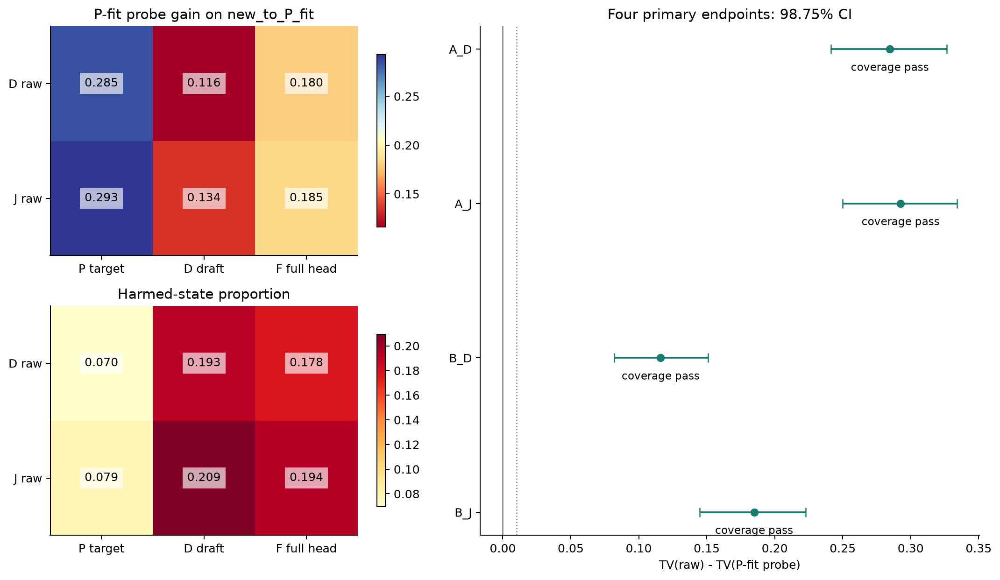
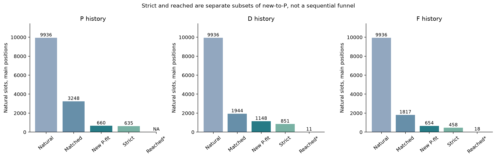
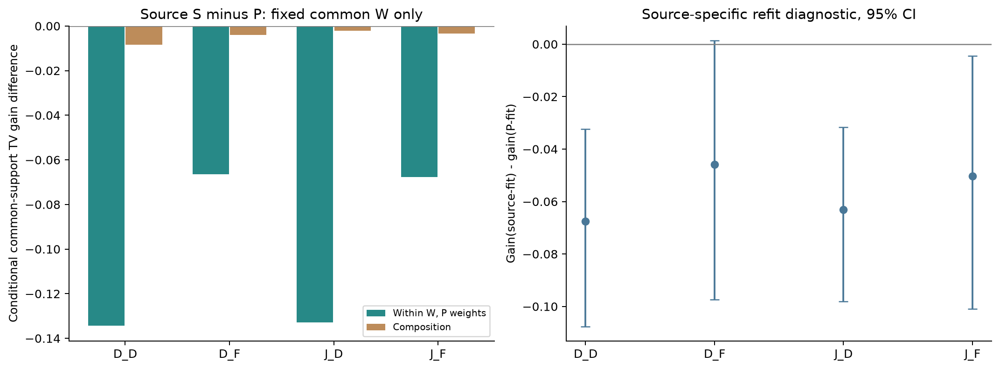
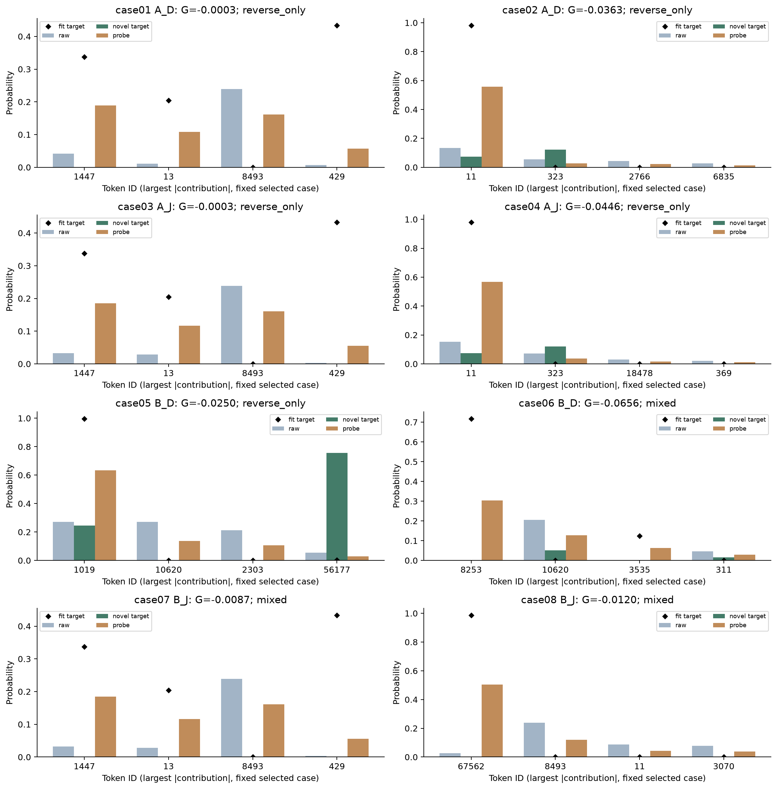

# R8：共同失配的跨主体与历史来源检验

Run `20261015T110214Z_mismatch_r8`。新36题固定采集与规定分析完成；科学支持逐端点判定，工程complete不等于一般理论成立。

D/J分别为E2独立DFlash raw与联合主体raw；P/D/F分别为target、独立草稿、联合主体加完整原头的自采样历史。同题同C、两个raw对三种H评分，每个主体各自用P-fit构造M/2探针。

**共同偏差是否跨主体存在？** 两个冻结主体各自存在跨历史共同可改善的偏差，获得有限支持；这不表示同一个动作可跨模型直接移用。A_D=0.284707，98.75% CI [0.241495, 0.326554]；A_J=0.292591，[0.249938, 0.334037]。两者使用相同P-eval状态与权重，不把总体raw误差相近当结构相同。

**换到草稿历史后是否仍有效？** 两种指定草稿来源均获得有限迁移支持。B_D=0.116120，[0.081891, 0.150955]；B_J=0.184867，[0.144860, 0.222877]。始终用P-fit动作，F明确为联合主体加完整原头自行采样。被修正对象仍是raw q_D/q_J；B_J不比较q_F与探针，也不是把探针叠加到完整头上。覆盖不足也照报，未匹配是NA。

**哪些情况失败？** 平均可迁移不等于逐历史安全：主集合的域等权损伤率，D raw在P历史为6.96%、转D历史为19.28%；J raw在P历史为7.93%、转F历史为19.37%。固定共同W并使用P权重后，D/F历史的收益仍下降，所以本次差异不能只用前驱访问权重改变概括。完整token账本显示反向及反向/越界混合损伤；正贡献不足以补偿才构成净失败。固定规则得到8条模型–状态案例（来自3题），不把它们当8个独立重复。

**仍未证明什么？** 标签参与的概率探针不是无标签修复器，也不保证原basis/dose可达；没有识别容量、优化、联合训练或模型大小的唯一因果。本轮C仍由target生成，不能外推长期自生成上下文。参考reached覆盖很薄：D来源新历史主集合只有11个状态真正reached且缺HumanEval；F来源只有18个，覆盖G/H/A=4/2/1题。不能把普通proposal路径上的迁移提升为充分的reached确认，更不能写探针接受收益、native无偏或TPS；R2原passed=false警报保留。

本轮P/D/F主集合分别为660/1148/654个自然槽，覆盖35/34/35题；每来源全部主位置为9936槽。槽数仅说明条件覆盖，不是收益解释率或独立样本量。这里的“偏差”是raw与相应历史下target的概率差，不预设raw已等于target的精确边缘分布。

## 四主端点

|端点|TV改善|98.75% CI|有定义题G/H/A|非零动作题G/H/A|覆盖|支持|>0.01实质幅度|
|---|---:|---|---|---|---|---|---|
|A_D|0.284707|[0.241495, 0.326554]|12/12/11|12/12/11|True|正改善已支持|True|
|A_J|0.292591|[0.249938, 0.334037]|12/12/11|12/12/11|True|正改善已支持|True|
|B_D|0.116120|[0.081891, 0.150955]|11/12/11|11/12/11|True|正改善已支持|True|
|B_J|0.184867|[0.144860, 0.222877]|12/12/11|12/12/11|True|正改善已支持|True|

5000次域内整题bootstrap，四主区间98.75%；次要量95%描述。覆盖满足且上界<0时按原规则支持平均损伤；上界<0.01只排除本区间下至少0.01的均值幅度，不排除小正作用（详见PRIMARY_ENDPOINT_DECISIONS）。保留自然重复和零动作，门槛只控制表述。先在C/i平均，再位置、anchor、题面、域等权；没有有效题的域不以两域主均值替代。区间条件于本次固定有限历史库，不覆盖所有采样或训练随机性。

## 六格完整结果与覆盖

|诊断raw / 来源|raw TV（主子集）|P-fit探针G|95% CI|损伤率|零动作率|主状态 / 匹配 / 自然|
|---|---:|---:|---|---:|---:|---|
|D / P|0.866882|0.284707|[0.251508, 0.317204]|0.069569|0.124942|660 / 3248 / 9936|
|D / D|0.712918|0.116120|[0.089693, 0.143623]|0.192775|0.192798|1148 / 1944 / 9936|
|D / F|0.795399|0.180495|[0.147382, 0.212229]|0.177740|0.170008|654 / 1817 / 9936|
|J / P|0.882427|0.292591|[0.258654, 0.325659]|0.079349|0.118628|660 / 3248 / 9936|
|J / D|0.762159|0.134277|[0.101555, 0.169768]|0.209234|0.160601|1148 / 1944 / 9936|
|J / F|0.811085|0.184867|[0.153611, 0.215465]|0.193705|0.133392|654 / 1817 / 9936|

主集合要求同W=(C,i,前驱)的P-fit内至少两种完整H，eval H未在同C/i全部P-fit出现。D/F-fit是否见过不改变主资格。strict all-fit-novel另表；i1/2是结构性负控，不能放宽资格。

## 严格三来源all-fit未见（预定次要描述）

|raw / 来源|严格未见G|95% CI|损伤率|自然槽|有定义题G/H/A|
|---|---:|---|---:|---:|---|
|D_P|0.294197|[0.258735, 0.328449]|0.071553|635|12/12/11|
|D_D|0.123974|[0.095019, 0.154896]|0.201042|851|11/12/11|
|D_F|0.187978|[0.155253, 0.220269]|0.190439|458|12/12/11|
|J_P|0.301523|[0.265714, 0.335842]|0.081334|635|12/12/11|
|J_D|0.139768|[0.106370, 0.175604]|0.202761|851|11/12/11|
|J_F|0.183967|[0.153329, 0.213887]|0.208014|458|12/12/11|

本表以strict子集按既定层级平均；它与下文三桶的原matched权重贡献不同，不能拿本表均值代替贡献去还原总体，也不替换四主检验。

## 两主体方向与来源差异

|来源|配对G(J)−G(D)|95% CI|两非零动作余弦|共同上移质量|共同下移质量|
|---|---:|---|---:|---:|---:|
|P|0.007884|[-0.004784, 0.024675]|0.957250|0.302901|0.191267|
|D|0.018157|[-0.001973, 0.041997]|0.913691|0.232630|0.149436|
|F|0.004372|[-0.008165, 0.020415]|0.929798|0.265833|0.166695|

全自然raw TV(J)−raw TV(D)的同状态配对及95%区间另存CROSS_BODY_SOURCE_MATRIX.paired_same_source；不能用误差均值相近证明方向等价。方向余弦只对两动作非零的状态定义，其分母不同；不由相关性认定一般修复机制。完整逐token D/J动作与共同升/降、相反方向的质量账本见PAIRED_DIRECTION_LEDGER，原始两动作均已封存。

|raw / 来源对比P|共同W内P权重的组内差|W组成项|共同支持内自然均值差|有效C/i|
|---|---:|---:|---:|---:|
|D_D|-0.134389|-0.008355|-0.142744|64|
|D_F|-0.066356|-0.003965|-0.070321|68|
|J_D|-0.132756|-0.002147|-0.134903|64|
|J_F|-0.067604|-0.003356|-0.070960|68|

固定W并采用P权重时，两raw主体转到D历史的组内差分别为−0.134389/−0.132756，转到F历史为−0.066356/−0.067604。也就是说，在这批共同支持内，弱化并未随W权重固定而消失；它伴随同W内实际历史及target需求的改变。两项逐C/i精确还原共同W内的差，不能外推为全来源总差、因果分解或某个原因的百分比。EOS、未匹配和共同W支持损失分别记录在COVERAGE与SUPPORT_STANDARDIZATION。

|raw / 来源|同源fit探针−P-fit探针G|95% CI|共同未见状态|
|---|---:|---|---:|
|D_D|-0.067621|[-0.107643, -0.032280]|707|
|D_F|-0.045778|[-0.097416, 0.001474]|275|
|J_D|-0.063129|[-0.098009, -0.031575]|707|
|J_F|-0.050255|[-0.100991, -0.004531]|275|

固定同源重新识别并未相对P-fit探针自动补回收益：四个差值点估计均负。它只在两fit都合格、同一eval H未见于两者同C/i全部fit的共同支持上配对；不能替换主动作。有限fit16抽样、组内需求异质性和保守共同流的限制仍混在一起，不能据此判定某种训练来源更差或锁定唯一失败原因。

## 三桶与真实失败

|raw / 来源|matched G|P-fit seen贡献|only-other seen贡献|strict novel贡献|严格桶权重|
|---|---:|---:|---:|---:|---:|
|D_P|0.290305|0.202995|0.001493|0.085817|0.278180|
|D_D|0.121506|0.018346|0.007082|0.096078|0.750600|
|D_F|0.185353|0.064524|0.016984|0.103845|0.594272|
|J_P|0.291358|0.203544|0.002314|0.085501|0.278180|
|J_D|0.134556|0.019580|0.012385|0.102592|0.750600|
|J_F|0.180831|0.060833|0.019201|0.100797|0.594272|

三桶使用原matched层次权重：贡献相加还原总G，零桶质量保留，不把只有该桶的题面另平均后冒充贡献。seen的M/2是数学保证，不作为泛化证据；new_to_P_fit等于后两桶，严格novel只指第三桶。

|raw / 来源|主集损伤率|反向类（受损中）|越界类（受损中）|混合类（受损中）|正token和|负token和|
|---|---:|---:|---:|---:|---:|---:|
|D_P|0.069569|0.894544|0.000000|0.105456|0.298759|-0.014052|
|D_D|0.192775|0.066746|0.000000|0.933254|0.172601|-0.056481|
|D_F|0.177740|0.306100|0.000000|0.693900|0.226855|-0.046360|
|J_P|0.079349|0.875533|0.000000|0.124467|0.306141|-0.013550|
|J_D|0.209234|0.074770|0.000000|0.925230|0.190711|-0.056434|
|J_F|0.193705|0.341644|0.000000|0.658356|0.232256|-0.047388|

逐token贡献0.5(|p−q|−|p−q−a|)使用完整词表，正负和还原G。所有严格负贡献均入账，不用1e−5裁掉小token；1e−5仅判断状态损伤。反向/越界是事后概率分类，不识别训练起因。[固定案例与完整账本](MECHANISM_CASES_CN.md)。

固定规则的第一个B_D案例case05展示了具体反向：同C、i=3、前驱“:”下，P-fit背景完整H为“Background:”，草稿新H为“Description:”。对token1019（两个星号后单换行），raw=0.271950，probe=0.633571；fit背景target=0.996402，新H target却只有0.245085。新H更需要token56177（两个星号后双换行，target=0.754914），探针反而把它从0.053550降到0.028572。全词表正贡献+0.168321不足以补偿−0.193299，总G=−0.024978；背景fit的+0.361620是构造保证。它说明这个固定共同流在新H上反向，不证明不存在另一个共同改善动作，也不识别“Description”一词的语义因果或原头训练起因。该例位于原D策略首拒之后，不是已到达前缀上的损伤例。

## 原策略参考reached

|原策略来源|accepted proposal / 参考块|95% CI|路径数|
|---|---:|---|---:|
|D|3.954861|[3.330143, 4.598987]|3312|
|F|4.940394|[4.232603, 5.651939]|3312|

原策略reached的新历史局部量另列如下，都是次要描述，分母与四主量不同：

|来源 / 被诊断raw|new_to_P_fit reached槽|有定义题G/H/A|局部G|95%描述CI|
|---|---:|---|---:|---|
|D / D|11|2/0/2|NA|NA（缺HumanEval）|
|D / J|11|2/0/2|NA|NA（缺HumanEval）|
|F / D|18|4/2/1|0.162680|[0.077845, 0.247515]|
|F / J|18|4/2/1|0.250248|[0.160932, 0.339564]|

F来源的正向描述区间不能解除极薄题面覆盖；D来源不以两域均值补成三域结果。普通D/F主集合分别有1148/654槽，原策略reached仅11/18槽。这个差异正是本轮接受边界之一，不说明探针能改变这些路径。

F验证用产生token的实际q_F；D用q_D。reached包括首拒位置，首拒后不再累计接受；EOS/轮初预算门控不包含本位接受事件。不生成bonus或残差输出。原策略到达的匹配/novel/strict主位置局部G及独立分母见REFERENCE_REACHED_SUPPLEMENT，不能把它称为探针部署接受收益。

## 采集、访问与理论边界

固定36题来自原GSM200/HumanEval164/Alpaca500面板，每域12题，K64=fit16/eval48、两anchor、三来源一次共同采集；没有补题追覆盖。开发只用R7旧6题，每源K16。最新机制暴露排除后余量为48/12/422；机制新留出不表示项目评测、模型训练或预训练从未见。训练元数据精确匹配记录数=0，语义与预训练重合仍未知。

开发保存并独立复现3960条全15位置D/F验证事件，实际检查原始完整块头对照55条，容差2e−5。fresh有69个有效C、99360条全位置验证事件；其余10位置只保留标量/缓冲SHA，不声称可重建每个完整target向量。BF16→FP64全概率与PCG64类别采样是新的HF参考口径，不与R7 FP32或生产vLLM逐位等价。

独立完整性审计和导出入口读过混合eval字节；隔离的是动作构造与选择。P动作入口只读P-fit target与两个raw，不读其他fit或eval；D/F-fit各自构造并一并封存后才评估eval。动作访问日志、签名和代码SHA可核，但同UID不是OS安全隔离。主采样、动作与统计源码在新采集前封存；报告、账本索引和独立检查辅助工具在采集中、派生效果打开前实现并另记版本，不冒称其全为锁前源码。

已知文献讨论了教师/学生历史测度差异、并行依赖与蒸馏拟合问题；本轮不以公式或工程过关作创新。见[定向一手核验范围](../sources/R8_READING_CN.md)；[GKD v3](https://arxiv.org/html/2306.13649v3)的训练认识不替本轮冻结迁移补证，[Domino v1](https://arxiv.org/html/2605.29707v1)的训练分工也不识别本地唯一因果。

保留R1条件KL主导未证、R2几何增量未支持、R3统一半强度不优、R4一般解释增量不确定、R6风险/方向优势未确认，以及R2原native passed=false和旧资源/证书披露。科学结论限本轮固定两个主体、同C和指定自然历史来源；不把局部TV归因独立DFlash→完整模型的正式AC/TPS全部增益。

本轮按固定范围收束，不拟合预测器、不训练主体/头、不加LP、native、RNG或剂量支路，也不自动开启第九轮。预算、真实宿主身份、共享预约释放与静态文件SHA见RUN_AUDIT和COMPLETION。
