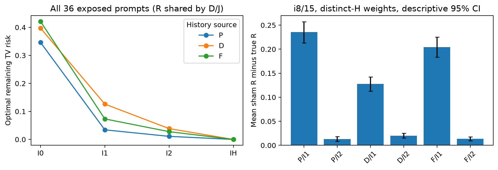
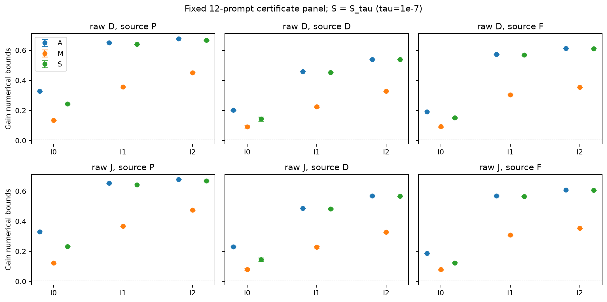
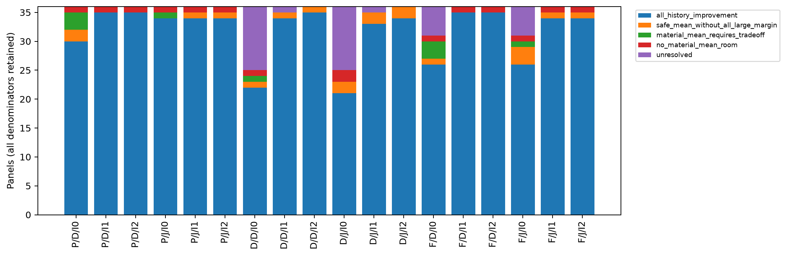
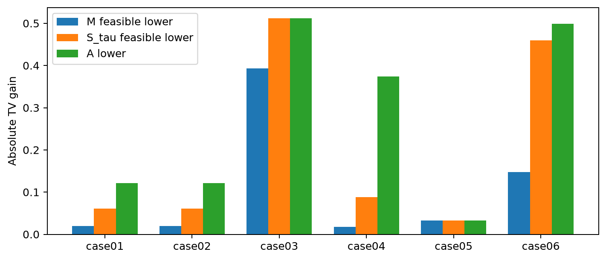

# R9：失配的共同安全余量与信息取舍

Run `20261015T144624Z_mismatch_r9`。全部是R8已暴露数据的CPU再分析，未采新题、未加载模型、GPU=0。A是允许部分历史损伤的最大平均改善，M是全体最低改善保证，S^τ是允许每支最多1e−7损伤时的最大平均改善。

**哪些失配还有共同安全余量？** 固定12题证书面板中，I0包含至少两种完整H的190个raw–来源–位置面板里，137个有全体改善超过0.01的完整词表见证，159个有容差安全平均改善超过0.01的见证。它们说明这些有限族在对应幅度内仍能共同修；不能据此判断保留原头实际收益时也能无损。单历史面板另计，不拿它证明跨历史兼顾。

**哪些改善幅度确实要求牺牲某些历史？** 上述非单历史I0面板中，126个满足A下界−S^τ上界>0.01：存在可达到的平均收益超过安全上界，因此追求该幅度至少伤害一条历史超过τ。其中9个的S^τ上界已≤0.01且A下界>0.01。其余不由M≈0或平均动作受损率推出必然取舍；具体宽界按未判定保留。

**区分历史解除了什么限制？** 表中I0/I1/I2固定相同p/q和频数，只改变哪些H必须共用预测；R下降的数值幅度说明相应有限族中不能被共享预测消除的需求差异。细化单调与i3/I2=IH本身是数学控制。i8/15的真/假分组对照在后表单独回答风险层面是否有超出组数的历史组织性，不能替M/S排除所有组数效应。A/M/S连续界与固定案例给出允许取舍和安全兼顾的区别。

**哪些来源仍未识别？** 本轮把表达能力完全放开，认证的是有限历史族的信息合并限制和同信息下仍可消除的偏差。没有识别模型规模、训练数据、训练目标、容量或优化的因果责任；没有未见历史保证、跨C可学性、原basis/dose可达或部署收益。旧R2原passed=false警报及R1/R2/R3/R4/R6负结果保留。

为什么这些边界直接回答失配：每条历史给出一个以其target为中心、以原raw误差为半径的TV球（S^τ再放宽τ）；安全共同预测必须同时落在这些球内。若交集中还有更低平均风险的点，就存在共同安全余量；若要求的收益超过交集的认证上限，即使允许任意完整词表分布也必须取舍。历史需求不同本身并不等于没有交集，也不等于交集中没有改善。这里没有把raw假定成target的精确平均。

固定i8/15同大小假分组给出的风险层面结果：P/I1：真分组风险更低（有限描述）；P/I2：真分组风险更低（有限描述）；D/I1：真分组风险更低（有限描述）；D/I2：真分组风险更低（有限描述）；F/I1：真分组风险更低（有限描述）；F/I2：真分组风险更低（有限描述）。这些是已暴露数据的95%整题描述，不能冒充未见确认，也不替M/S排除组数作用。

## 固定真实例：共同余量和高收益取舍可以同时存在

GSM固定例case01/02是同一个四历史面板。完整词表见证可让每条历史都改善至少 **0.019653**；容差安全的平均改善上限为 **0.0608487844**，而平均最优改善至少 **0.1216406238**。所以要求平均改善0.12时，任何I0共同分布都至少伤害一条历史超过τ；同时，较低幅度的共同改善确实可行。按前驱I1分组后，安全平均改善的已认证下界升到 **0.1735652645**，足以在容差内保护各支并超过0.12。改变的只是允许区分的历史，p/q与频数保持不变。

同一原始q在“'s work”后给“ through”0.006478，而target为0.997280；在43/48槽出现的“'s break”后，target对“ through”只有1.817e−8，主要需要“ this / the / down”。平均最优的oracle共同分布偏向高频需求，展示动作使“work”这支TV恶化0.008133；这个动作的表现只作说明。**必需损伤来自S上界与目标收益的比较，不来自选中动作伤了哪条历史。** 没有证明每个共享动作都会伤害“work”这一指定支。

HumanEval固定例case03显示了共同可修偏差的具体形状：四历史中完整共同动作可保证各支改善至少 **0.3933936419**，安全平均改善已达 **0.5115280725**，数值界覆盖该组平均极限。展示的“ is a”和“'s a”两支中，raw都高估“ Python”“ completed”、低估“ complete”；共同质量重分配能补偿各支其他token上的局部损伤。这一例说明，历史需求仍有差别时，也可能在预设数值精度内保住该信息集下的平均最优收益。全四支证明在完整账本中，不能只凭展示的两支判断。

HumanEval固定例case04进一步给出i8的明确边界：I0的安全平均上限为 **0.0880304356**，平均最优下界为 **0.3739687792**；平均改善0.30在I0可达却不可能容差安全。允许按前驱区分时，S下界为 **0.8079859807**，解除这一收益目标的兼顾限制。对应自然历史“...implementation of”要求“ the”约0.999858，“...satisfies the”则要求“ problem”约0.540621；全族28种H的约束共同构成证书。这里识别的是该有限决策问题的信息限制，不是某个词的语义因果，也不证明M/S的变化已排除所有组数作用；后者的假分组只检验R。

六条展示项对应 **五个唯一面板、三条题面**：case01与case02相同；Alpaca case05只有一种H，是单目标控制。它们不是六个独立重复。全部190个非单历史I0面板及未判定仍在原分母中；固定案例不代替全量结果。详细概率、完整词表贡献与输入引用见[案例账本](MECHANISM_CASES_CN.md)。

## 全量风险：36题、69C、三来源全部eval主槽

|来源|raw D误差E|raw J误差E|R0|R1|R2|IH|
|---|---:|---:|---:|---:|---:|---:|
|P|0.646516|0.647938|0.346262|0.034292|0.011022|0.000000|
|D|0.563020|0.581125|0.397218|0.126286|0.038747|0.000000|
|F|0.614329|0.609248|0.421044|0.073298|0.027825|0.000000|

每来源9936个自然槽，保留完整H重复频数；无P-fit匹配/novel/原头成败筛选。R只依赖target族与分组，D/J共用同一个R；两个raw只改变E和A/M/S。P为target历史，D为独立草稿历史，F为联合主体加原完整头的历史；F不是joint raw。IH风险为0只是数学参照。完整逐面板自然/不同H等权、A与95%描述区间见MEAN_RISK.json。

## 12题固定证书：数值界与未判定

|来源 / raw / 信息|A数值界|M数值界|S^τ数值界|M/S未闭合面板|
|---|---|---|---|---:|
|P/D/I0|[0.328482, 0.328482]|[0.134183, 0.134193]|[0.242700, 0.243873]|1/36|
|P/D/I1|[0.650692, 0.650692]|[0.356894, 0.356896]|[0.639418, 0.639802]|5/36|
|P/D/I2|[0.676109, 0.676109]|[0.450850, 0.450852]|[0.666469, 0.666563]|1/36|
|P/J/I0|[0.330225, 0.330225]|[0.121822, 0.121831]|[0.231684, 0.232862]|1/36|
|P/J/I1|[0.652434, 0.652434]|[0.367433, 0.367436]|[0.641150, 0.641567]|5/36|
|P/J/I2|[0.677852, 0.677852]|[0.474025, 0.474025]|[0.668099, 0.668192]|1/36|
|D/D/I0|[0.201638, 0.201638]|[0.083775, 0.098358]|[0.129440, 0.157745]|20/36|
|D/D/I1|[0.457933, 0.457933]|[0.221519, 0.229469]|[0.450489, 0.454035]|15/36|
|D/D/I2|[0.539436, 0.539436]|[0.328139, 0.328187]|[0.538421, 0.538533]|6/36|
|D/J/I0|[0.230144, 0.230144]|[0.073488, 0.085783]|[0.132404, 0.156493]|20/36|
|D/J/I1|[0.486439, 0.486439]|[0.222295, 0.232620]|[0.480160, 0.483020]|16/36|
|D/J/I2|[0.567943, 0.567943]|[0.328403, 0.328442]|[0.567253, 0.567363]|6/36|
|F/D/I0|[0.190571, 0.190571]|[0.090014, 0.095755]|[0.145782, 0.155535]|19/36|
|F/D/I1|[0.572187, 0.572187]|[0.303923, 0.304370]|[0.568995, 0.569128]|9/36|
|F/D/I2|[0.611676, 0.611676]|[0.354630, 0.354641]|[0.610442, 0.610516]|5/36|
|F/J/I0|[0.185907, 0.185907]|[0.076217, 0.080647]|[0.117663, 0.127362]|19/36|
|F/J/I1|[0.567523, 0.567523]|[0.308110, 0.308563]|[0.564116, 0.564228]|5/36|
|F/J/I2|[0.607012, 0.607012]|[0.353229, 0.353242]|[0.606056, 0.606119]|4/36|

表中各界先在信息组内求证，再R/S按自然权重聚合、M取组最小值；位置、anchor、题、域逐级等权。数值界与抽样区间不是一回事。COMMON_BOUNDARIES.json另给每个界的5000次域内整题95%描述区间；所有数据已暴露，区间条件于该有限历史库，不能称未见确认。S^τ是容差安全，不写成精确零损伤。

|来源/raw/信息|全部历史>0.01|安全均值>0.01、M不足|安全上界≤0.01且平均有余量|平均无实质余量|未判定|A下界−S上界>0.01|
|---|---:|---:|---:|---:|---:|---:|
|P/D/I0|30|2|3|1|0|24|
|P/D/I1|35|0|0|1|0|2|
|P/D/I2|35|0|0|1|0|1|
|P/J/I0|34|0|1|1|0|24|
|P/J/I1|34|1|0|1|0|2|
|P/J/I2|34|1|0|1|0|1|
|D/D/I0|22|1|1|1|11|18|
|D/D/I1|34|1|0|0|1|4|
|D/D/I2|35|1|0|0|0|1|
|D/J/I0|21|2|0|2|11|17|
|D/J/I1|33|2|0|0|1|2|
|D/J/I2|34|2|0|0|0|1|
|F/D/I0|26|1|3|1|5|21|
|F/D/I1|35|0|0|1|0|4|
|F/D/I2|35|0|0|1|0|1|
|F/J/I0|26|3|1|1|5|22|
|F/J/I1|34|1|0|1|0|4|
|F/J/I2|34|1|0|1|0|1|

每行36个位置面板，未判定留总分母。M/S间隙目标1e−4；A间隙目标1e−8。648个raw×信息面板中M闭合539、S闭合508；总5488个信息组×raw，含892个一般多历史组。未闭合不等于不可修。几乎已正确的某支可把M卡住，相关标志单列在原表，不能一律归为冲突。

## 历史内容与细分数量：固定16次假分组

|来源/信息（i8/15）|假组R−真组R|95%描述区间|
|---|---:|---|
|P/I1|0.235861|[0.213013, 0.257034]|
|P/I2|0.013141|[0.008517, 0.018109]|
|D/I1|0.127616|[0.112813, 0.142244]|
|D/I2|0.020068|[0.015107, 0.025335]|
|F/I1|0.204154|[0.183565, 0.225142]|
|F/I2|0.013372|[0.009263, 0.017953]|

不同完整H等权；I1在全族置乱标签，I2在真实I1内置乱，保留组大小。正值表示真分组的风险更低，区间是整题描述而非16次置乱的精确p值。i3/I2已完全识别H，任何同大小分组也为单历史风险0，仅作控制。没有可移动标签或全部单历史组时为结构性无信息，另见结构审计。该对照只检验R，不证明M/S变化已排除所有组数作用。

## 证书怎样回答“能修”和“必须取舍”

完整词表合法见证证明存在；active+tail仅为完整simplex外层松弛，用来给优化上界。原始d_j始终来自完整词表。完整候选逐支重算，桶安全不能当完整安全；不安全候选只有经已认证正margin见证混合、完整复核后才能提高S下界。独立审计不依赖solver.fun/success，使用非负Lagrangian乘子与box-infimum重算。上界宽只写未判定。

两历史的M由三角不等式与线段见证给出；多历史不能由逐对结果推全体。小词表M=0但S>0、逐对正却整组M=0、平均可改善但S=0的合同是已知数学，不是本地模型发现。详见理论卡片和MATHEMATICAL_BASIS。

固定最多6例见[MECHANISM_CASES_CN.md](MECHANISM_CASES_CN.md)，每例完整词表p/q、共同动作、正负token账本和SHA保留。展示的是所有动作能力放开后的边界，不将原头当前一好一坏作为必要损伤证据。平均最优动作受损率不等于必然受损率。

## 核验、资源与停止

数学合同36组通过；输入276文件核SHA；固定3旧dev×D/J工程及独立证书复算通过。全部固定工作完成度、对偶/见证重算、资源身份、静态SHA见RUN_AUDIT、CERTIFICATE_AUDIT、COMPLETION。优化是有外扩guard的FP64/long-double数值证书，非有理数精确证明；旧R4线程/证书披露不因复用方法消失。本轮所有数值库与HiGHS线程1，单worker；GPU=0。

[理论卡片](THEORY_CARD_CN.md)区分标准工具、项目假说、实测证书和未知外推。已有风险/信息决策论工具参见[COLT 2012原文](https://proceedings.mlr.press/v23/garcia12.html)；未做穷尽新颖性/引用审计，不说首次。AI辅助实现、核验和报告。固定任务后停止，不自动下一轮。

本轮新增资源警报：HiGHS内部time_limit曾未限制一次真实wall，单目标测得173.075833秒（超过30秒），全部CPU仍计账。已停止自有worker并改为外部隔离子进程硬限，故意阻塞合同、原数学合同与固定dev均重新验收；两次中断组保留合法宽界不重跑。该历史超限保留，不能将本轮单组时限审计写成全通过；数值结论仍须独立证书通过。
